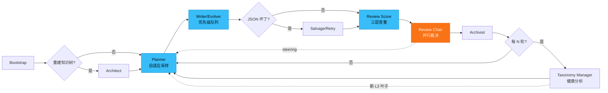

# cuda-sft-qgen

LangGraph 多智能体流水线，为 NVIDIA CUDA 知识域生成 **SFT 问题集**（本阶段只出题、不出答案）。

出题由版本化知识图谱驱动，保留原有三层分类导航。**每道候选题都经过独立模型完整审查**；无法确认、解析失败或调用失败的题保留待审，不会默认放行。生成与审题并行推进，知识扩充与资料审计在后台运行。

迁移、知识审计、导出和基准说明：[knowledge-and-review.md](docs/implementation/knowledge-and-review.md)。现有 JSONL 首次使用时备份为 `.legacy`，SQLite 成为权威存储；原始题库不会在安装或测试时自动迁移。

## 特性亮点

- **31 个 L1 领域**的三层分层 Taxonomy（Domain → L2 Category → L3 Leaf）
- **多 API Key 优先级调度**：LLM 与 Embedding 独立槽位，支持并行 & 背压控制
- **三层查重**：SHA256 → SimHash/Jaccard → Embedding Cosine（阈值可配置）
- **Prompt Cache + Embedding Cache**：预取优化，节省 60-80% API 成本
- **Retry Queue + Salvage**：容错机制处理 JSON 损坏和 API 429 错误
- **Steering 反馈循环**：Review Chair → Planner 动态纠偏分布失衡
- **知识图谱**：SQLite 断言修订、官方来源证据、依赖关系、后台扩充与每日到期审计
- **事务归档**：审核结果原子提交、可恢复任务、知识纠错影响追踪和问题集导出
- **配置 Profile 支持**：dev/test/prod 预设，环境变量优先级覆盖

## 多 Agent 协同



| Agent | 作用 |
|---|---|
| **Architect** | 可选，一次性给最稀疏 L2 扩叶子 |
| **Planner** | 按配额 + steering 抽任务单；硬件必须与叶子 claim 兼容；v2 自适应采样 |
| **Writer / Evolver** | 并行出题；规则筛只拦空泛题；hw/leaf 进 pending 记 warning |
| **Salvage** | 修损坏 JSON，不改题意；支持结构化 fallback |
| **Review Score** | embedding 三层查重 + 多样性统计；批量预取缓存 |
| **Review Chair** | 每题独立审查正确性、可答性、知识匹配、答案泄漏及实际标签；失败保留 pending |
| **Archivist** | SQLite 事务归档，JSONL 兼容导出，索引可重建 |
| **Taxonomy Manager** | 后台扩充 provisional 知识，按官方证据审计；修订失效关联题目 |

LLM 优先级：Writer > Salvage > Chair > Sieve > Taxonomy。`--fake` 跳过 Taxonomy sidecar。

## 快速开始

```bash
python -m venv .venv && source .venv/bin/activate
pip install -e ".[dev]"
cp .env.example .env   # 配置 NVIDIA_API_KEY / _2 / _3
```

**基础命令**：
```bash
# 生成 1000 题（使用默认配置）
cuda-sft-qgen generate --target 1000

# 使用 dev profile（快速迭代）
export CUDA_SFT_PROFILE=dev
cuda-sft-qgen generate --target 100

# 使用 prod profile（最高质量）
export CUDA_SFT_PROFILE=prod
cuda-sft-qgen generate --target 5000

# 测试模式（无需 API key）
cuda-sft-qgen generate --fake --target 8 --batch 4

# 恢复中断的生成
cuda-sft-qgen resume

# 查看统计数据
cuda-sft-qgen stats

# 验证配置
cuda-sft-qgen validate-config --verbose

# 估算成本
cuda-sft-qgen estimate-cost --target 1000 --profile prod
```

**Taxonomy 管理**：
```bash
# 重建知识树
cuda-sft-qgen rebuild-taxonomy

# 健康分析
cuda-sft-qgen manage-taxonomy --analyze

# 完整管理周期（分析 + 扩展）
cuda-sft-qgen manage-taxonomy --tick --max-leaves 12 --apply

# 手动扩展指定领域
cuda-sft-qgen manage-taxonomy --expand --domain memory --facet failure --max-leaves 10 --apply
```

产物：`data/questions.sqlite3`、`data/knowledge.sqlite3`，以及 accepted/rejected/pending JSONL 和统计快照。正式训练导出使用 `cuda-sft-qgen export --output data/training.jsonl`，排除未独立审查、fake 和失效题；内部参考答案不导出。

查重：L0 SHA256 → L1 骨架 SimHash/Jaccard → L2 embedding cosine；附近邻全文交给审题模型，批内只与质量通过的存活题比较。向量默认 `nvidia/nemotron-3-embed-1b`。

`THINKING_LEVEL=none|medium|high`；`reasoning_content` 默认不落盘（`LOG_REASONING=1` 才记）。

## 配置系统

### Profile 支持

三种内置 profile（`configs/profiles/`）：

- **dev.yaml**: 快速迭代，较小 batch，温度 0.9
- **test.yaml**: 最小资源，单线程，禁用 Taxonomy Manager
- **prod.yaml**: 严格质量，最大吞吐，温度 1.0

**使用方式**：
```bash
# 环境变量
export CUDA_SFT_PROFILE=prod
cuda-sft-qgen generate --target 2000

# 或在代码中
from cuda_sft_qgen.config_v2 import load_config_v2
config = load_config_v2(profile="dev", target=500)
```

### 配置优先级

CLI 参数 > 环境变量 > Profile YAML > default.yaml

**示例**：
```bash
# 使用 prod profile 但覆盖温度
export CUDA_SFT_PROFILE=prod
export TEMPERATURE=0.85
cuda-sft-qgen generate --target 1000
```

### 自定义 Profile

创建 `configs/profiles/myprofile.yaml`：
```yaml
generation:
  temperature: 0.95
  writer_concurrency: 10
  evolver_fraction: 0.25

review:
  batch_size: 25
  semantic_dup_threshold: 0.93

paths:
  data_dir: data/myprofile
```

使用：
```bash
CUDA_SFT_PROFILE=myprofile cuda-sft-qgen generate --target 2000
```

## 性能调优

### 并发设置

```bash
# 多 API Key 线性扩展（最多推荐 8 个）
export NVIDIA_API_KEY=nvapi-xxx
export NVIDIA_API_KEY_2=nvapi-yyy
export NVIDIA_API_KEY_3=nvapi-zzz

# 每个 key 的并发数（2-4 推荐，过高会 429）
export LLM_PER_KEY_CONCURRENCY=3
export EMBED_PER_KEY_CONCURRENCY=2

# Embedding 超配（可以更高，调用更快）
export EMBED_OVERSUB=3
```

### 缓存优化

```yaml
generation:
  prompt_cache: true         # 节省 ~60% prompt tokens
  embedding_cache: true      # 节省 ~80% embedding calls
```

### 质量控制

```yaml
review:
  semantic_dup_threshold: 0.94   # 提高=更少判重
  semantic_gray_threshold: 0.90  # 灰区范围
  chair_max_workers: 4          # 每题均审查，此项控制并发
```

### 成本估算

```bash
# 预估 1000 题成本
cuda-sft-qgen estimate-cost --target 1000 --profile prod

# 典型输出（3 keys, prod profile）:
# {
#   "cost_usd": {
#     "llm_total": 22.50,
#     "embeddings": 0.85,
#     "total": 23.35
#   }
# }
```

**性能基准**（3 API keys, prod profile）：
- 吞吐：30-50 questions/min
- 延迟：Writer 3-8s, Review Chair 2-4s
- 内存：2-4 GB
- 成本：1000 题约 $20-25
