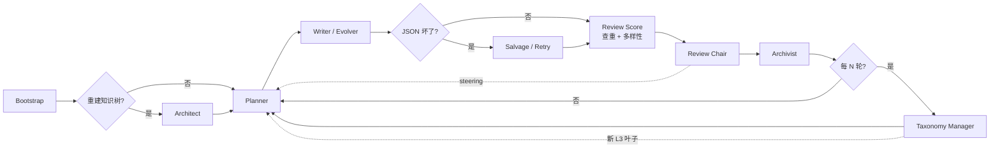

# cuda-sft-qgen

LangGraph 多智能体流水线，为 NVIDIA CUDA 知识域生成 **SFT 问题集**（本阶段只出题、不出答案）。

出题先锁知识树再抽样；审题默认放行、只拦重复；分布问题用 steering 回传给出题组，不删题。Taxonomy Manager 在审题之后旁路补叶子，不插入出题/审题主线。

## 多 Agent 协同



| Agent | 作用 |
|---|---|
| Architect | 可选，一次性给最稀疏 L2 扩叶子 |
| Planner | 按配额 + steering 抽任务单 |
| Writer / Evolver | 并行出题；Evolver 改结构不出同义句 |
| Salvage | 修损坏 JSON，不改题意 |
| Review Score | embedding 三层查重 + 多样性统计 |
| Review Chair | 宽松；只写 steering，不因失衡拒题 |
| Archivist | 落盘 accepted / rejected |
| Taxonomy Manager | 旁路：健康分析 / 反馈搜点 / 扩叶子；可用 CLI 单独跑 |

LLM 优先级：Writer > Salvage > Chair > Sieve > Taxonomy。`--fake` 跳过 Taxonomy sidecar。

## 快速开始

```bash
python -m venv .venv && source .venv/bin/activate
pip install -e ".[dev]"
cp .env.example .env   # NVIDIA_API_KEY / _2 / _3
```

```bash
cuda-sft-qgen generate --target 1000
cuda-sft-qgen generate --fake --target 8 --batch 4
cuda-sft-qgen resume
cuda-sft-qgen stats
cuda-sft-qgen rebuild-taxonomy
cuda-sft-qgen manage-taxonomy --analyze
cuda-sft-qgen manage-taxonomy --tick --max-leaves 12 --apply
```

产物：`data/accepted.jsonl`、`data/rejected.jsonl`、`data/stats.json`。

查重：L0 SHA256 → L1 骨架 SimHash/Jaccard → L2 embedding cosine（默认 ≥0.94 才拒，灰区放过）。向量默认 `nvidia/nemotron-3-embed-1b`。

`THINKING_LEVEL=none|medium|high`；`reasoning_content` 默认不落盘（`LOG_REASONING=1` 才记）。
