# cuda-sft-qgen

LangGraph 多智能体流水线，为 NVIDIA CUDA 知识域生成 **SFT 问题集**（本阶段只出题、不出答案）。

出题由版本化知识图谱驱动，保留原有三层分类导航。**每道候选题都经过独立模型完整审查**；无法确认、解析失败或调用失败的题保留待审，不会默认放行。生成与审题并行推进，知识扩充与资料审计在后台运行。

迁移、知识审计、导出和基准说明：[knowledge-and-review.md](docs/implementation/knowledge-and-review.md)。现有 JSONL 首次使用时备份为 `.legacy`，SQLite 成为权威存储；原始题库不会在安装或测试时自动迁移。

## 特性亮点

- **31 个 L1 领域**的三层分层 Taxonomy（Domain → L2 Category → L3 Leaf）
- **多 API Key 优先级调度**：LLM 与 Embedding 独立槽位，支持并行 & 背压控制
- **三层查重**：SHA256 → SimHash/Jaccard → Embedding Cosine（阈值可配置）
- **Prompt Cache + Embedding Cache**：预取优化，节省 60-80% API 成本
- **Retry Queue + Salvage**：容错机制处理 JSON 损坏和 API 429 错误
- **Steering 反馈循环**：Review Chair → Planner 动态纠偏分布失衡
- **知识图谱**：SQLite 断言修订、官方来源证据、依赖关系、后台扩充与每日到期审计
- **事务归档**：审核结果原子提交、可恢复任务、知识纠错影响追踪和问题集导出
- **配置 Profile 支持**：dev/test/prod 预设，环境变量优先级覆盖

## 多 Agent 协同

默认走 **并发协调器**（`generation.concurrent_pipeline=true`）：主线程审题归档，后台一条 `generation-stage` 线程出题，`KnowledgeWorker` 守护线程做知识扩充与官方文档审计。关掉并发后回退到顺序 LangGraph。

LLM 槽位优先级（数字越小越先拿到 key）：**Writer=0 > Salvage=1 > Chair=2 > Sieve=3 > Taxonomy=4**。`--fake` 不启动 KnowledgeWorker。Chair 对 `formula/debug/layout/code_complete` 的 uncertain 结果会再审一次；连续审题失败触发熔断。

### 总览：并发流水线（默认）

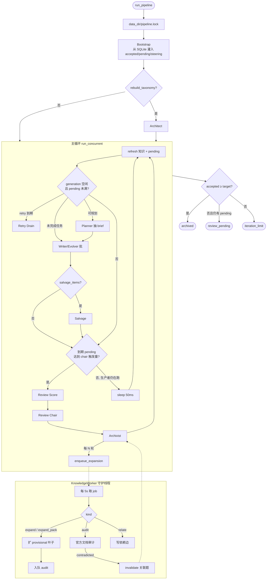

| Agent | 模块 | 作用 |
|---|---|---|
| **Bootstrap** | `graph/nodes/bootstrap.py` | 从 archive 恢复计数、pending、steering、run_state |
| **Architect** | `graph/nodes/architect.py` | 可选首轮：把 Taxonomy 扩充任务丢给后台 worker |
| **Planner** | `graph/nodes/planner.py` + `planner.py` | 配额 + steering + 叶子硬件兼容，抽 Writer/Evolver 任务单 |
| **Writer / Evolver** | `graph/nodes/generate.py` | 并行出题；规则筛只拦空泛题；hw/leaf 记 warning 进 pending |
| **Salvage** | `generate.salvage_item` / `salvage.py` | 修损坏 JSON，不改题意；修不了进 retry 队列 |
| **Retry Drain** | `graph/nodes/salvage.py` | 到期 429/JSON 任务再跑一轮 Writer |
| **Review Score** | `graph/nodes/review.py` | embedding 近邻 + 三层指纹；不在此步放行 |
| **Review Chair** | `graph/nodes/review.py` | 每题独立审查；失败/不确定保留 pending，绝不默认 accept |
| **Archivist** | `graph/nodes/review.py` `archive_node` | SQLite 事务提交；登记知识依赖；投影 JSONL |
| **Taxonomy / Knowledge** | `knowledge_worker.py` | 后台扩叶子、官方证据审计、修订失效关联题 |

### 顺序图（`concurrent_pipeline=false`）

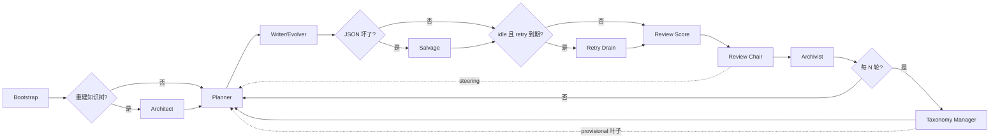

---

### Bootstrap

从磁盘把一次可恢复运行灌进图状态。不调 LLM。

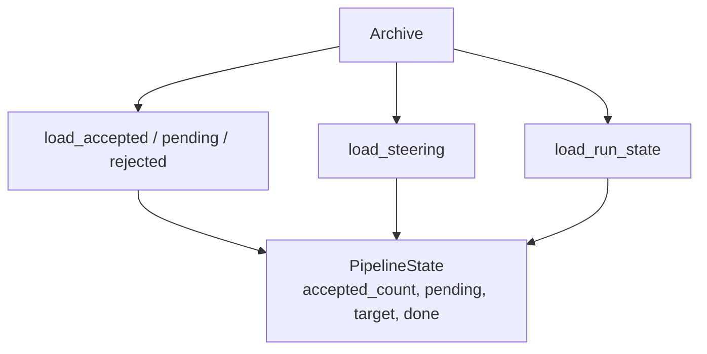

- 输入：`questions.sqlite3`（及 JSONL 投影）
- 输出：`pending`、`steering_brief`、`iteration` / `review_rounds`
- `accepted ≥ target` 且无 pending 时直接结束

### Architect

仅 `--rebuild-taxonomy` 时走一次。本身不阻塞出题，只把扩叶子任务排队。

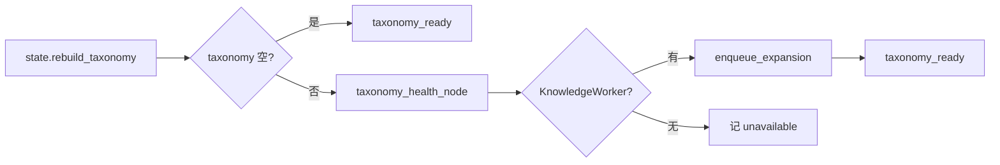

### Planner

按配额缺口、Chair steering、叶子健康度抽 **QuestionBrief**。硬件标签必须与叶子 claim 兼容（`leaf_hardware_allowed`），避免 Writer 写出立刻被 hw 筛掉的题。

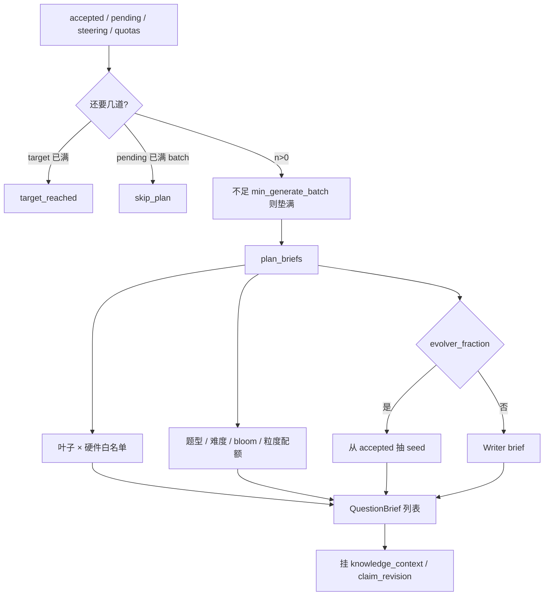

- 自适应采样：`configs/planner.yaml` 的 `adaptive_sampling`（可关）
- 输出：`batch_briefs`，iteration +1

### Writer / Evolver

一条 brief 一次 LLM。Evolver 改训练结构，不是同义改写。并发由 `PriorityExecutor` + API key 池背压控制。

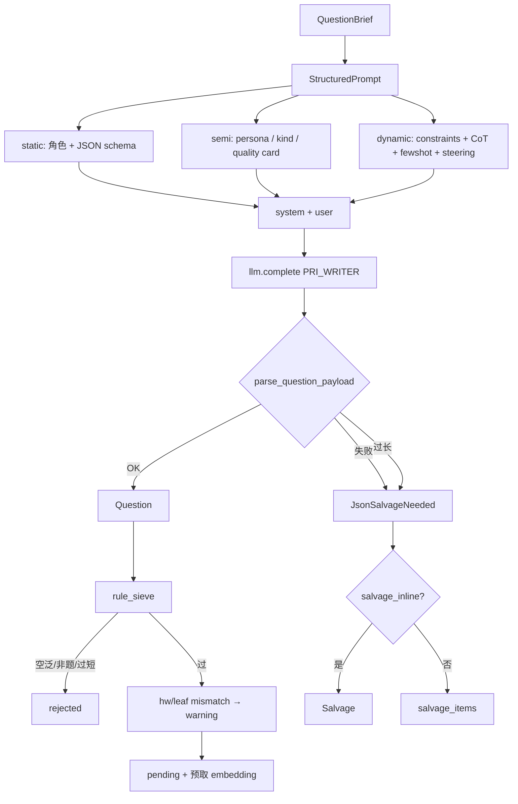

Prompt 分层：`writer.md` / `evolver.md` + `layers/{constraints,quality,context,cot,writer_policy,evolver_policy}.md`。

规则筛（`sieve.py`）只拦：过短过长、缺 claim、不像问题、不像 CUDA、开口太空。`sieve_hw_mismatch` / `sieve_off_leaf` 在 Writer 路径上是 warning，交给 Chair。

### Salvage

只修 JSON 外壳，不改考点。本地解析优先，再可选 Salvage LLM。

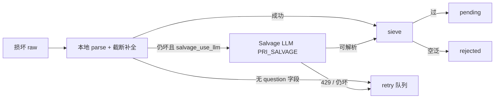

Retry 队列：指数退避；超过 `RETRY_MAX_ATTEMPTS` 记 `retry_exhausted`。

### Retry Drain

pending 为空（或并发协调器里还有审题空位）且队列到期时，把 brief 再送进 Writer。新鲜出题优先于 JSON 重试，避免 drain 堵满审题。

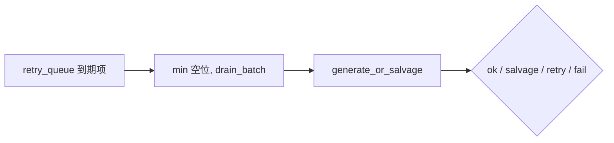

### Review Score

检索邻居、打多样性报告。**不在这一步 accept**。到期未审的题才进本批；backoff / exhausted 的题延后。

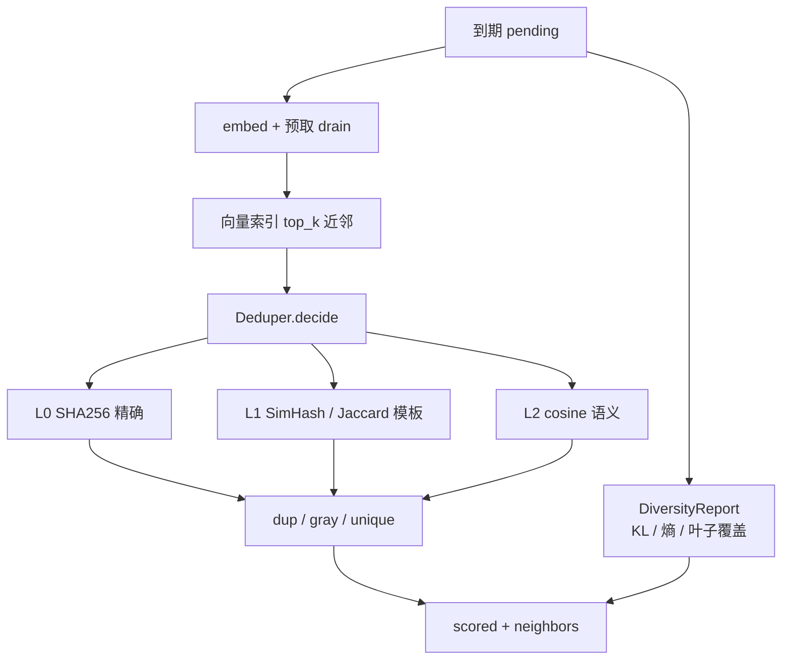

### Review Chair

每道候选（含 unique）各打一次独立审查。解析失败、ID 对不上、证据不足、调用失败 → **pending**，带指数退避，用尽后 `review_exhausted` 留待人工，永不默认放行。

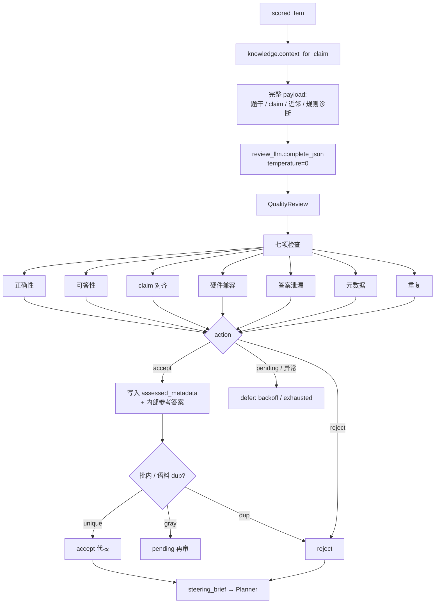

Chair 并发：`chair_max_workers`。审查模型可用独立 `review.model`，缺省与出题模型相同。

### Archivist

审查结果与计数一次事务提交。向量索引是派生数据，失败不影响权威库。

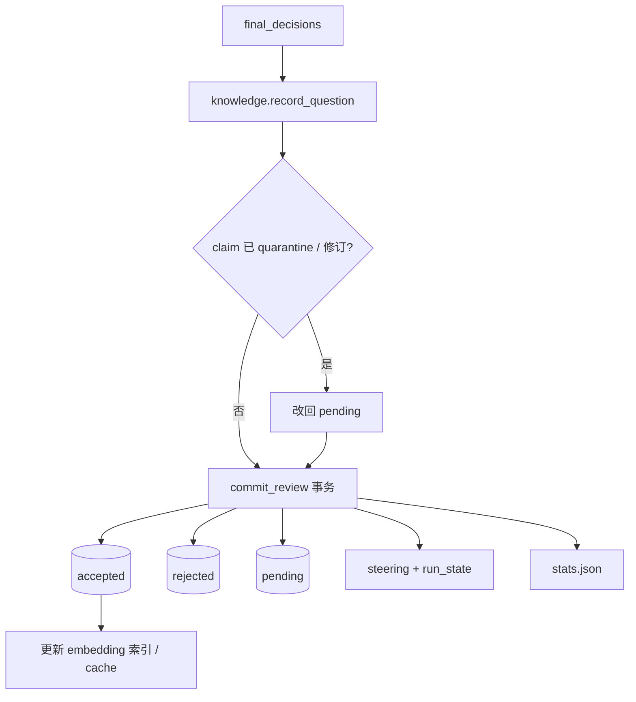

导出训练数据用 `cuda-sft-qgen export`：只要独立审查通过、非 fake、未失效的题；内部参考答案不导出。

### Taxonomy Manager / KnowledgeWorker

不插入出题/审题主线。主循环每 `every_k_reviews` 轮 `enqueue_expansion`；worker 自己租约执行。

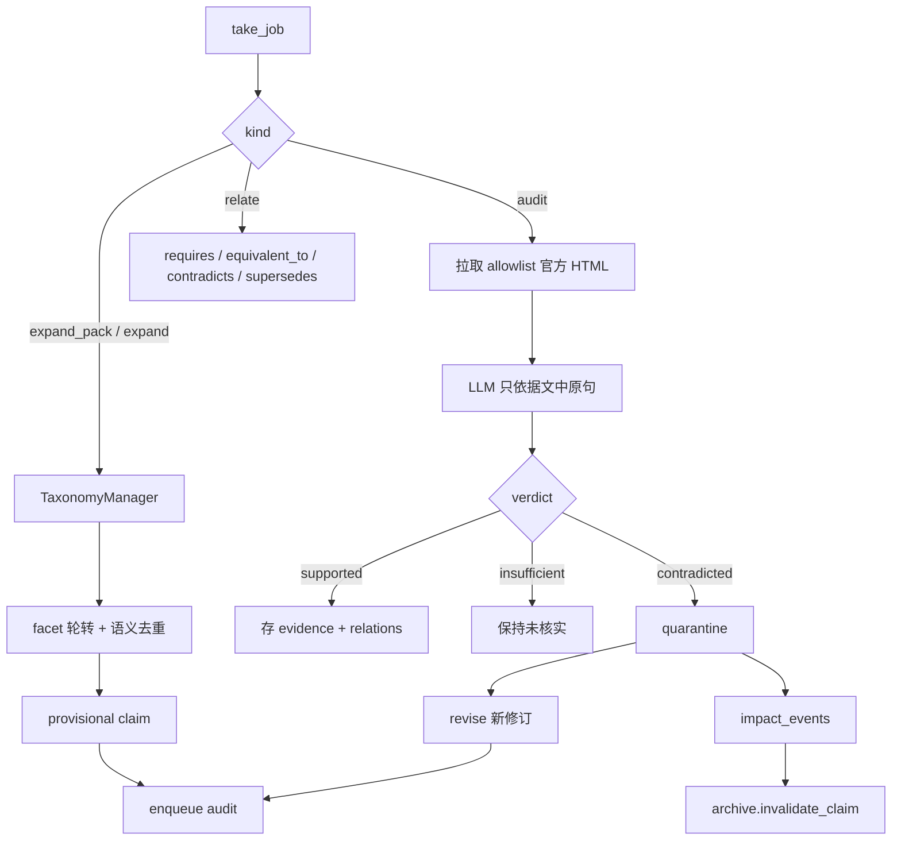

新叶子立即可被 Planner 抽到；官方审计通过前状态为 `provisional`。导入的旧叶子是 `legacy_unreviewed`。

### API Key 池（跨 Agent）

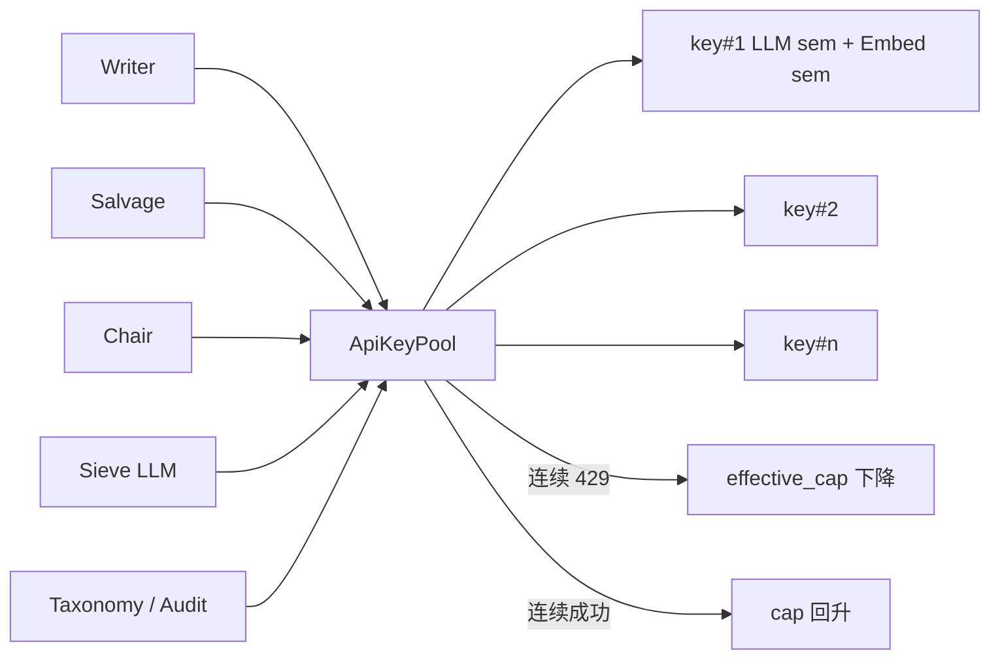

LLM 与 Embedding 信号量独立。优先级数字：**Writer=0 > Salvage=1 > Chair=2 > Sieve=3 > Taxonomy=4**。Chair 默认 `review.priority=2`，不再与 Writer 抢同一档。

注释约定见 [comment-standard.md](docs/implementation/comment-standard.md)。

### 系统上下文（启动到落盘）

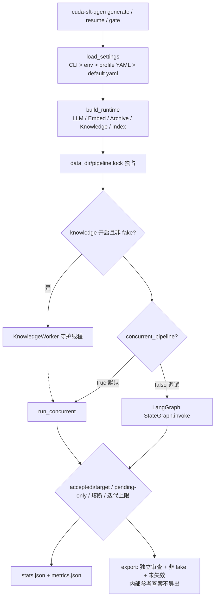

### 交接契约（MAST：避免智能体错位）

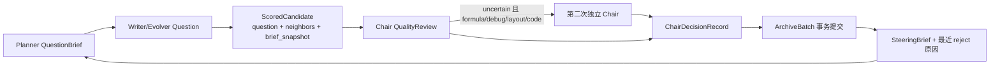

### 错误状态机

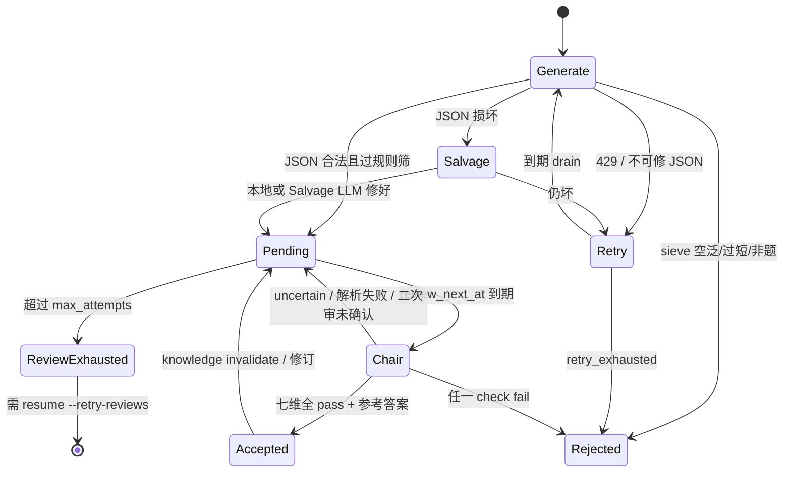

熔断：连续 `review_error` 达到 `circuit_breaker_error_streak`，或 `review_exhausted` 达到 `circuit_breaker_exhausted`，主循环以 `status=review_pending` 停，不空转。

### SQLite 权威存储与导出

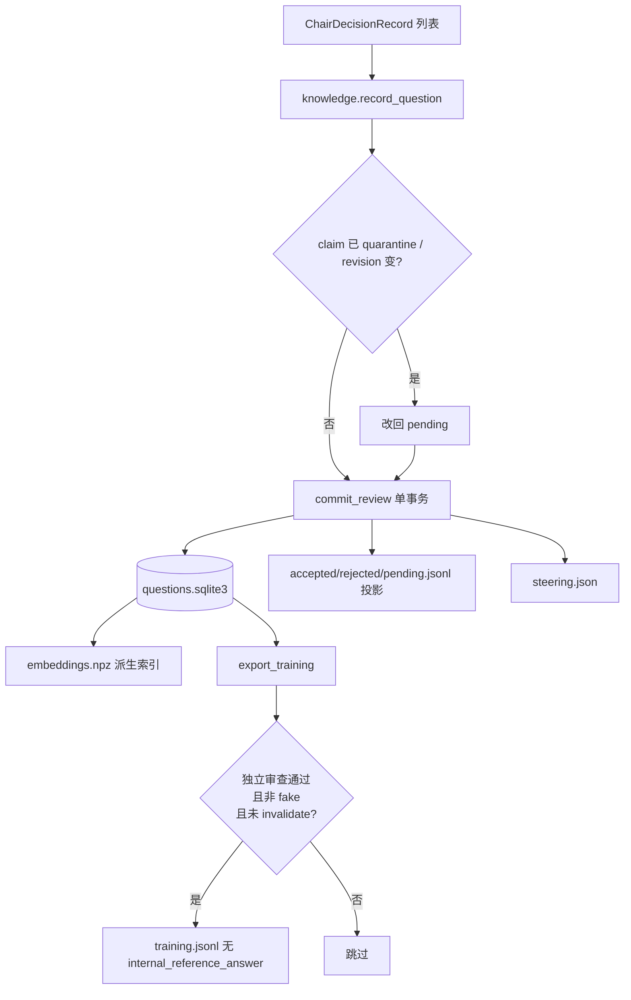

durable generation_tasks 与 retry 租约也在 `questions.sqlite3`：进程崩溃后 `resume` 先跑未完成 task，再抽新 brief。

## 快速开始

```bash
python -m venv .venv && source .venv/bin/activate
pip install -e ".[dev]"
cp .env.example .env   # 配置 NVIDIA_API_KEY / _2 / _3
```

**基础命令**：
```bash
# 生成 1000 题（使用默认配置）
cuda-sft-qgen generate --target 1000

# 使用 dev profile（快速迭代）
export CUDA_SFT_PROFILE=dev
cuda-sft-qgen generate --target 100

# 使用 prod profile（最高质量）
export CUDA_SFT_PROFILE=prod
cuda-sft-qgen generate --target 5000

# 测试模式（无需 API key）
cuda-sft-qgen generate --fake --target 8 --batch 4

# 恢复中断的生成
cuda-sft-qgen resume

# 查看统计数据
cuda-sft-qgen stats

# 验证配置
cuda-sft-qgen validate-config --verbose

# 估算成本
cuda-sft-qgen estimate-cost --target 1000 --profile prod
```

**Taxonomy 管理**：
```bash
# 重建知识树
cuda-sft-qgen rebuild-taxonomy

# 健康分析
cuda-sft-qgen manage-taxonomy --analyze

# 完整管理周期（分析 + 扩展）
cuda-sft-qgen manage-taxonomy --tick --max-leaves 12 --apply

# 手动扩展指定领域
cuda-sft-qgen manage-taxonomy --expand --domain memory --facet failure --max-leaves 10 --apply
```

产物：`data/questions.sqlite3`、`data/knowledge.sqlite3`，以及 accepted/rejected/pending JSONL 和统计快照。正式训练导出使用 `cuda-sft-qgen export --output data/training.jsonl`，排除未独立审查、fake 和失效题；内部参考答案不导出。

查重：L0 SHA256 → L1 骨架 SimHash/Jaccard → L2 embedding cosine；附近邻全文交给审题模型，批内只与质量通过的存活题比较。向量默认 `nvidia/nemotron-3-embed-1b`。

`THINKING_LEVEL=none|medium|high`；`reasoning_content` 默认不落盘（`LOG_REASONING=1` 才记）。

## 配置系统

### Profile 支持

三种内置 profile（`configs/profiles/`）：

- **dev.yaml**: 快速迭代，较小 batch，温度 0.9
- **test.yaml**: 最小资源，单线程，禁用 Taxonomy Manager
- **prod.yaml**: 严格质量，最大吞吐，温度 1.0

**使用方式**：
```bash
# 环境变量
export CUDA_SFT_PROFILE=prod
cuda-sft-qgen generate --target 2000

# 或在代码中
from cuda_sft_qgen.config_v2 import load_config_v2
config = load_config_v2(profile="dev", target=500)
```

### 配置优先级

CLI 参数 > 环境变量 > Profile YAML > default.yaml

**示例**：
```bash
# 使用 prod profile 但覆盖温度
export CUDA_SFT_PROFILE=prod
export TEMPERATURE=0.85
cuda-sft-qgen generate --target 1000
```

### 自定义 Profile

创建 `configs/profiles/myprofile.yaml`：
```yaml
generation:
  temperature: 0.95
  writer_concurrency: 10
  evolver_fraction: 0.25

review:
  batch_size: 25
  semantic_dup_threshold: 0.93

paths:
  data_dir: data/myprofile
```

使用：
```bash
CUDA_SFT_PROFILE=myprofile cuda-sft-qgen generate --target 2000
```

## 性能调优

### 并发设置

```bash
# 多 API Key 线性扩展（最多推荐 8 个）
export NVIDIA_API_KEY=nvapi-xxx
export NVIDIA_API_KEY_2=nvapi-yyy
export NVIDIA_API_KEY_3=nvapi-zzz

# 每个 key 的并发数（2-4 推荐，过高会 429）
export LLM_PER_KEY_CONCURRENCY=3
export EMBED_PER_KEY_CONCURRENCY=2

# Embedding 超配（可以更高，调用更快）
export EMBED_OVERSUB=3
```

### 缓存优化

```yaml
generation:
  prompt_cache: true         # 节省 ~60% prompt tokens
  embedding_cache: true      # 节省 ~80% embedding calls
```

### 质量控制

```yaml
review:
  semantic_dup_threshold: 0.94   # 提高=更少判重
  semantic_gray_threshold: 0.90  # 灰区范围
  chair_max_workers: 4          # 每题均审查，此项控制并发
```

### 成本估算

```bash
# 预估 1000 题成本
cuda-sft-qgen estimate-cost --target 1000 --profile prod

# 典型输出（3 keys, prod profile）:
# {
#   "cost_usd": {
#     "llm_total": 22.50,
#     "embeddings": 0.85,
#     "total": 23.35
#   }
# }
```

**性能基准**（3 API keys, prod profile）：
- 吞吐：30-50 questions/min
- 延迟：Writer 3-8s, Review Chair 2-4s
- 内存：2-4 GB
- 成本：1000 题约 $20-25
