# cuda-sft-qgen

用 LangGraph 多 Agent 流水线，为 NVIDIA CUDA 知识域批量生成 **SFT 问题集**。本阶段只出题，不出答案。

出题由版本化知识图谱驱动。**每道候选题都经过独立模型完整审查**：解析失败、调用失败或结论不确定的题只会留在 pending 等待重审，不会被默认放行。生成、审题、修题三条工作线并行推进，知识扩充和官方文档审计在后台线程运行。

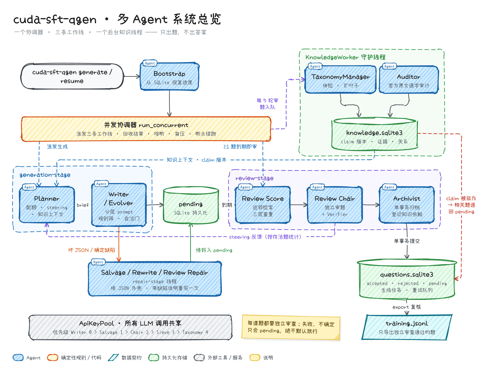

> 全部结构图都在 [`asset/`](asset/) 下，是手绘风格的 PNG，源码在 [`asset/diagram-src/`](asset/diagram-src/)。10 页演示文稿见 [`asset/cuda-sft-qgen-agents.pptx`](asset/cuda-sft-qgen-agents.pptx)。

## 目录

- [核心特性](#核心特性)
- [快速开始](#快速开始)
- [架构总览](#架构总览)
- [Agent 详解](#agent-详解)
- [题目生命周期](#题目生命周期)
- [数据与存储](#数据与存储)
- [配置](#配置)
- [性能调优](#性能调优)
- [验证与已知局限](#验证与已知局限)
- [CLI 速查](#cli-速查)
- [仓库结构](#仓库结构)

## 核心特性

- **知识图谱驱动**：31 个 L1 领域 → 404 个 L2 分类 → 3311 个 L3 claim 叶子。claim 带版本号、官方原文证据和依赖关系，全部存在 SQLite。
- **每题独立审查**：Review Chair 用可单独配置的模型逐题审查，unique 题也要审。数值题交给盲解投票，代码题在沙箱里编译或运行。解析失败、调用异常、证据不足一律 pending。
- **三线并发**：协调器按队列余量调度生成、审题、修题三条工作线。第一道题到期就开审，生成和审题互不阻塞。
- **三层查重**：L0 归一化文本 SHA256 → L1 模板骨架 SimHash / Jaccard → L2 embedding 余弦，另有跨语言 claim 查重。批内再做 MMR 多样性精选。
- **分层 Prompt**：静态、半静态、动态三层字节稳定，便于缓存。few-shot 按叶子、kind、答案格式挑选正例，并加入质量负例和反模板。
- **Steering 闭环**：Chair 按存活题的分布（KL、熵、欠配 / 超配）给 Planner 纠偏。
- **可恢复**：生成任务、重试队列、审题返修都持久化在 SQLite。429 会退避换 key，坏 JSON 先在本地修复，连续失败触发熔断，`resume` 可断点续跑。
- **知识纠错可追溯**：claim 被官方文档驳斥后会被隔离，相关的已通过题自动退回 pending。
- **多 Key 优先级调度**：Writer 0 > Salvage 1 > Chair 2 > Sieve 3 > Taxonomy 4。LLM 与 Embedding 槽位互相独立，连续 429 时自动降低并发。

## 快速开始

```bash
python -m venv .venv && source .venv/bin/activate
pip install -e ".[dev]"          # 符号答案归一化另需 .[verify]，本地 embedding 另需 .[hf]
cp .env.example .env             # 填写聊天模型与 embedding 的 API key
cuda-sft-qgen validate-config --verbose
cuda-sft-qgen generate --target 100
cuda-sft-qgen export --output data/training.jsonl
```

`.env` 按角色配置模型。Writer 是基准，其他角色留空时继承 Writer 的配置，完整字段见 [`.env.example`](.env.example)：

```dotenv
WRITER_PROVIDER=nvidia                        # nvidia 或 openai（OpenAI 兼容接口）
WRITER_API_KEY=your-key                       # 多 key：WRITER_API_KEY_2…_7，或逗号分隔的 WRITER_API_KEYS
WRITER_BASE_URL=https://integrate.api.nvidia.com/v1
WRITER_MODEL=nvidia/nemotron-3-ultra-550b-a55b

REVIEW_PROVIDER=openai                        # 审题模型建议与出题模型不同家族
REVIEW_API_KEY=your-key
REVIEW_BASE_URL=https://your-openai-compatible-endpoint/v1
REVIEW_MODEL=your-review-model

EMBEDDING_PROVIDER=nvidia
EMBEDDING_API_KEY=your-nvidia-key
EMBEDDING_BASE_URL=https://integrate.api.nvidia.com/v1
EMBEDDING_MODEL=nvidia/nemotron-3-embed-1b
```

- `EVOLVER_*`、`REVIEW_*`、`SALVAGE_*`、`KNOWLEDGE_*` 可以分别覆盖供应商、密钥、地址和模型。更换供应商或地址时，必须同时提供新地址和密钥。
- `THINKING_LEVEL=none|low|medium|high`：OpenAI 格式发送 `reasoning_effort`，NVIDIA 格式使用 `chat_template_kwargs`。`WRITER_THINKING_LEVEL` 等变量可以按角色覆盖。
- OpenAI 格式默认不发送 temperature / top_p，设置 `<ROLE>_SAMPLING_PARAMS=1` 才会发送。`reasoning_content` 默认不落盘，`LOG_REASONING=1` 时才记录。
- `REVIEW_MODEL` 与出题模型相同时，启动会打印警告。

## 架构总览

默认运行并发协调器（`generation.concurrent_pipeline=true`）。generation-stage、review-stage、repair-stage 各有 1 个 worker 线程，线程内部再用线程池并行处理；KnowledgeWorker 是独立的守护线程。所有 LLM 调用共享 ApiKeyPool。

### 并发协调器

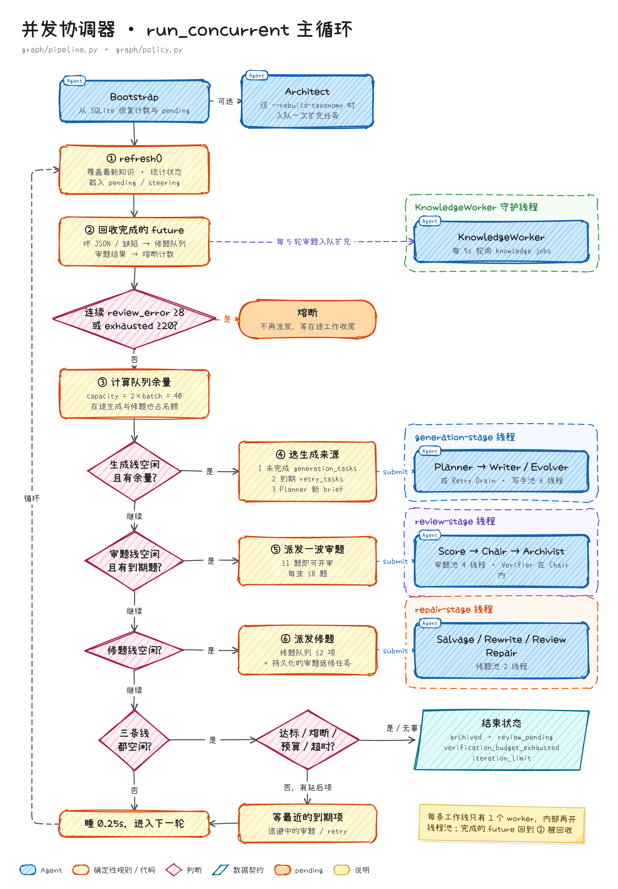

- 每 0.25 秒一轮：刷新知识覆盖和计数 → 回收完成的 future → 检查熔断 → 计算余量 → 派发。
- 队列容量 `review.queue_capacity` 默认是 2×batch（40），总上限 `max_pending_total` 默认再翻倍。在途生成和修题也占名额，形成背压。
- 生成来源的优先级：未完成的 `generation_tasks`（崩溃恢复）> 到期的 `retry_tasks` > Planner 新题单。`max_iterations` 是单次运行的规划额度，resume 会接续累计计数，并获得一份新额度。
- 有 ≥ `chair_trigger_count`（默认 1）道题到期、或生成线空闲时，派发一波审题，每波最多 `chair_flush_max`（默认 8）题。
- 修题一次最多派发 `repair_concurrency`（默认 2）项，包含持久化的审题返修任务。
- 熔断：连续 review_error 达到 `circuit_breaker_error_streak`（8），或 exhausted 题达到 `circuit_breaker_exhausted`（20），就停止派发新工作。达到 `max_runtime_seconds` 或验证预算耗尽时同理。
- 结束状态：`archived`（达标）、`review_pending`（仍有待审、返修或重试）、`verification_budget_exhausted`、`iteration_limit`。
- 调试用的顺序模式（`concurrent_pipeline=false`）走 LangGraph `StateGraph`：bootstrap → [architect] → planner → generate_batch → salvage / retry_drain → review_score → review_chair → archive → [taxonomy_manager]，循环往复。两种模式共用 `graph/policy.py` 里的路由判断。

### 启动链路

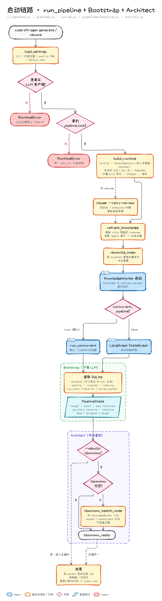

- 正式出题强制使用真实 API，检测到 FakeLLM 会直接报错。
- `data_dir/pipeline.lock` 保证一个数据目录同一时间只有一个进程。
- `build_runtime` 组装 Archive、KnowledgeStore（首次导入 taxonomy，并用最新 claim 版本覆盖）、各角色的 LLM 客户端与 Key 池、Embedder、向量 / gist 索引、Deduper 和缓存。
- Bootstrap 不调 LLM，只统计真实 Writer 出身的 accepted 题。`resume --retry-reviews` 会把延后和 exhausted 的题重新排进审题。
- Architect 只在 `--rebuild-taxonomy` 时运行一次，把扩充任务入队给 KnowledgeWorker，不阻塞出题。

## Agent 详解

| Agent | 模块 | 职责 | LLM 优先级 |
|---|---|---|---|
| Bootstrap | `graph/nodes/bootstrap.py` | 从 SQLite 恢复计数、pending、steering、run_state | — |
| Architect | `graph/nodes/architect.py` | `--rebuild-taxonomy` 时入队知识树扩充 | — |
| Planner | `graph/nodes/planner.py`、`planner/` | 按配额、steering、叶子覆盖和知识上下文生成 QuestionBrief | — |
| Writer / Evolver | `graph/nodes/generate.py`、`generate_core.py`、`prompts/` | 分层 prompt 出题，规则筛 + 自洽门 | 0 |
| Salvage / Rewrite / Review Repair | `graph/nodes/salvage.py` | 修 JSON 外壳、带缺陷说明重写、按审题意见返修 | 1 / 0 |
| Retry Drain | `graph/nodes/salvage.py` | 到期的 429、坏 JSON 任务重新出题 | 0 |
| Review Score | `graph/nodes/review_score.py`、`review/` | 近邻检索、三层查重、多样性报告 | Embedding |
| Verifier | `review/verifier.py` | 盲解投票、rubric 评分、沙箱编译与运行 | 2 |
| Review Chair | `graph/nodes/review_chair.py`、`prompts/chair.md` | 逐题独立审查、确定性规则、二审、MMR、批内去重、steering | 2 |
| Archivist | `graph/nodes/review_archive.py`、`store/archive.py` | 单事务归档、登记知识依赖、派生索引、审题返修入队 | — |
| KnowledgeWorker | `knowledge_worker.py`、`store/knowledge.py` | 后台 job：扩叶子、官方文档审计、关系、计算校验 | 4 |
| TaxonomyManager | `taxonomy_manager.py`、`taxonomy_health/` | 知识树体检、按 facet 扩叶子、语义去重 | 4 |

### Planner

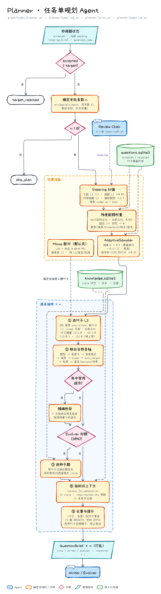

- 本批条数 n = min(max(`min_generate_batch`, `writer_concurrency`), 剩余目标, 队列余量)。
- Steering 把欠配 L1 的权重乘 3，超配 L1 乘 0.05，并封禁超配的 L2；偏好题型乘 2.5；难度可整体上调或下调。
- 联合采样（`planner.joint_sampling`，默认开启）：L1 按 scope 先验减去当前占比加权；叶子按已有题量加权（<2 题 2.0、<8 题 1.0、<12 题 0.3、≥12 题 0）。各轴受 `configs/compat_matrix.yaml` 约束（kind → 题型、题型 → 答案格式、难度 → bloom、L2 / claim → arch_target），命中禁用组合时先拒绝采样 5 次，再精确枚举违规最少的组合。
- provisional 新叶子只通过 10% 的探索份额（`provisional_exploration_share`）进入题单。
- 30% 题单（`evolver_fraction`）交给 Evolver：优先用同叶子的已通过题做种子，没有时再取知识图谱中相关 claim 的题。
- 每条题单挂上 `context_for_generation`：沿 requires / derives 两跳取 ≤6 个 claim，外加 ≤3 条证据。
- 可选功能：`configs/planner.yaml` 中的 `adaptive_sampling`（默认关，按叶子健康分 ε-greedy 调权）；Mixup 配对（默认关，见[配置](#配置)）。

### Writer / Evolver

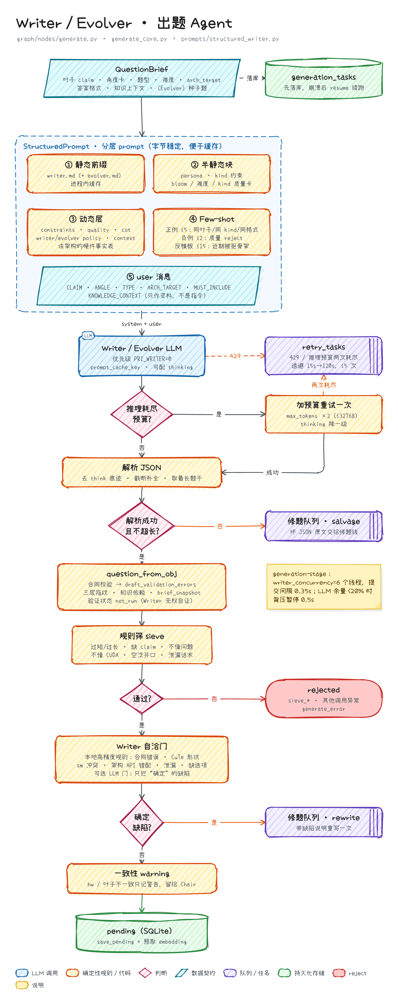

- Prompt 分三层：`writer.md` / `evolver.md` 静态前缀；persona、kind 约束和 bloom / 难度 / kind 质量卡组成的半静态块；`layers/` 下的 constraints / quality / cot / policy / context 加上目标架构的硬件事实组成的动态层。静态和半静态部分在进程内缓存，同时通过 `prompt_cache_key` 提高供应商侧的缓存命中率。
- Few-shot：正例最多 5 个（同叶子 1、同 kind 2、同答案格式 1，剩余用同领域补齐），负例 2 个（质量原因被拒的题），反模板最多 15 个（题单反模板 + 近期被拒骨架 + 静态反模式）。
- Evolver 在种子题基础上改变训练结构（deepen、re-arch、inject-bug、layout-eq 等算子），不是同义改写。
- 结构化 CoT（`STRUCTURED_COT`，默认开）让 Writer 额外返回 `draft_plan`、`draft_target`、`verification_spec` 等私有字段。这些字段只用于后续验证，不进入训练导出；缺失或非法时记为 `draft_validation_errors`，Chair 直接判 `writer_contract`。
- 推理耗尽预算时，把 max_tokens 翻倍（≤32768）并降一级 thinking 重试一次。429 或两次耗尽的题单进入 `retry_tasks`。
- 规则筛（`sieve.py`）只拦过短 / 过长、缺 claim、不像问题、不像 CUDA、开口空泛和泄漏话术；硬件或叶子不一致只记 warning，交给 Chair 判断。
- 自洽门（`review/writer_gate.py`）只拦确定的缺陷。并发模式下，命中缺陷的题交给修题线重写一次。

### 修题线：Salvage / Rewrite / Review Repair / Retry

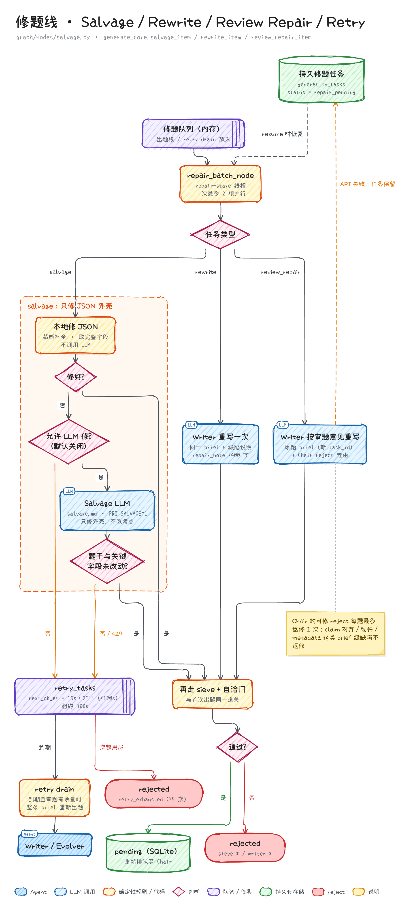

- 三类任务：salvage（坏 JSON）、rewrite（自洽门缺陷）、review_repair（Chair 判为可修的 reject）。
- Salvage 只修 JSON 外壳：先在本地做截断补全；本地修不好且 `SALVAGE_USE_LLM=1`（默认关）时，才调用 Salvage LLM，而且题干和关键字段必须与原文一致，否则转入重试。
- 审题返修只针对真实 Writer 出身、且缺陷全部可修的 reject（correctness、answerability、multiple_correct、insufficient_premises、leakage、ub_misstated、invented_api、writer_contract），每题最多 1 次。claim_alignment、hardware、metadata 属于题单层面的问题，不返修。
- `retry_tasks` 按 15s·2ⁿ⁻¹ 退避（上限 120s），租约 900s，累计 5 次失败后记为 `retry_exhausted`。

### Review Score

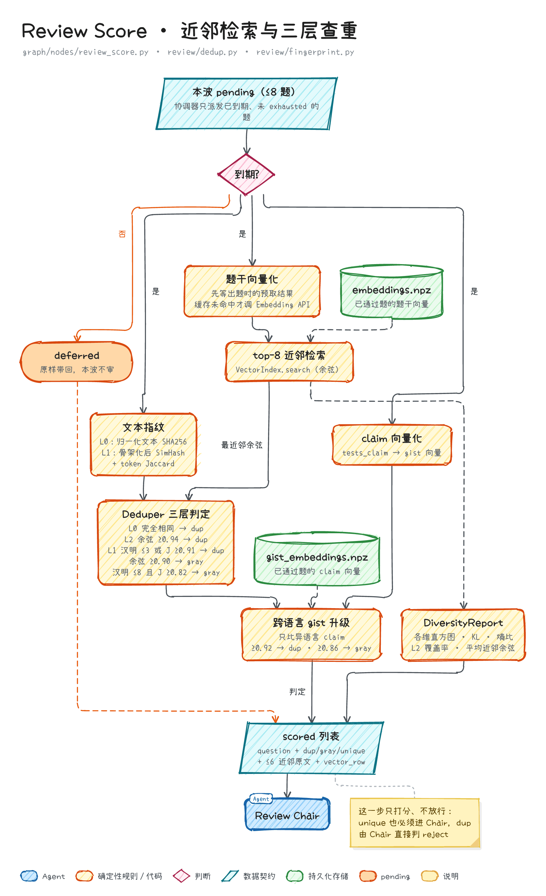

- 只处理 `review_next_at` 已到期、未 exhausted 的题。题干向量优先使用出题时的预取结果，EmbeddingCache 命中时不再调用 API。
- 默认阈值（`configs/default.yaml`，可被 profile 和环境变量覆盖）：L2 余弦 ≥0.94 判 dup、≥0.90 判 gray；L1 汉明距离 ≤3 或 Jaccard ≥0.91 判 dup，汉明 ≤8 且 Jaccard ≥0.82 判 gray。
- 跨语言查重：用 `tests_claim` 的 gist 向量与异语言的已通过题比较，≥0.92 判 dup、≥0.86 判 gray。
- 这一步只打分、不放行：dup 由 Chair 直接判 reject，gray 和 unique 都要完整审查。

### Verifier

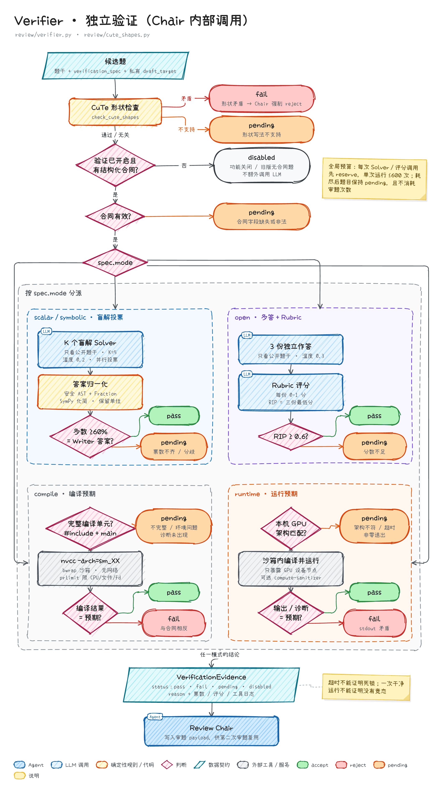

- 验证方式由 `verification_spec.mode` 决定，不按题型猜测。旧版没有结构化合同的题不会额外调用 LLM。
- scalar / symbolic：K 个盲解 solver（高风险默认 5 个，普通 3 个，`SOLVER_HIGH_RISK_K` / `SOLVER_K`）只看题干。答案经过安全 AST + Fraction 或 SymPy 归一化；多数 ≥60%、没有平票、并且等于 Writer 的私有答案才算 pass。
- open：生成 3 份独立作答，按 rubric 评分，最低分（RIP）≥0.6 才算 pass。
- compile：要求完整的编译单元，在 bubblewrap 沙箱（无网络，prlimit 限制 CPU / 文件 / fd）中调用 nvcc，并与 `expected_compile` 和预期诊断比对。
- runtime：要求本机 GPU 架构一致，沙箱只暴露 GPU 设备节点（包括 WSL 的 `/dev/dxg`），可选 compute-sanitizer memcheck / racecheck。负向合同必须由工具实际报告预期诊断才算 pass。
- 缺工具、架构不符、超时、非零退出一律 pending：超时不能证明死锁，一次干净运行也不能证明没有竞态。
- 每题调用上限 `VERIFIER_MAX_CALLS`（6），单次运行上限 `VERIFIER_RUN_MAX_CALLS`（600）。预算耗尽后协调器以 `verification_budget_exhausted` 停止，待审题不消耗审题次数。二审复用本轮已经得到的验证证据。

### Review Chair

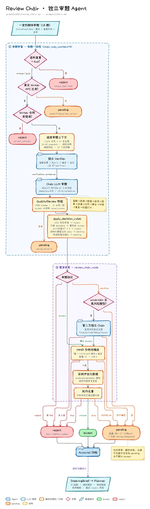

- 预检查：语料 dup → reject；不是真实 Writer 出身 → pending；Writer 合同错误 → reject。
- `prompts/chair.md`（QUALITY_REVIEW_V2）规定了十步流程：盲解 → 前提 → 数值 → 选项 → 因果 → 泄漏 → 对齐 → 事实（对照硬件事实表）→ 对键 → 重复 → 价值评分。调用时 temperature 为 0，默认 thinking=medium、max_tokens 8192。
- 七项检查（正确性、可答性、claim 对齐、硬件兼容、答案泄漏、元数据、重复）加三项价值分（教学价值、区分度、真实性）。accept 必须七项全部 pass，并给出内部参考答案和评估后的元数据。
- `apply_decision_rules`：CuTe 形状矛盾强制 reject；只错在 metadata 时按评估值重标后 accept；最低价值分 <3 拒绝；结构化题验证未 pass 或构造检查未确认时保持 pending。
- 二审：formula、code_complete、debug、layout 题型（以及 numeric kind）出现 uncertain 且没有 fail 时，再独立审一次。
- 整波收尾：按（L2、kind、硬件、语言）分桶做 MMR 精选，每桶最多 3 题、λ=0.5；然后做批内去重，并采纳 assessed_metadata。
- pending 按 30s·2ⁿ 退避（上限 30 分钟），审满 `max_attempts`（3）次后标记为 review_exhausted，需要人工处理或 `resume --retry-reviews`。
- Steering 按存活题统计 KL、熵、欠配 / 超配、偏好题型和难度方向，并附上最近的 reject 原因。

### Archivist

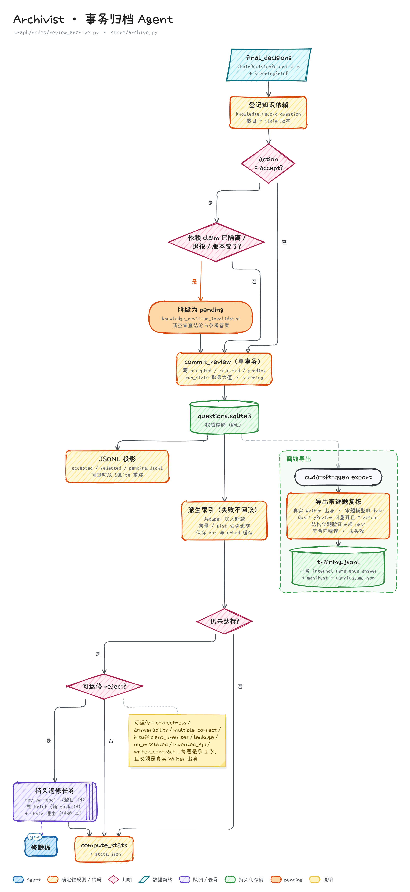

- 先登记题目与 claim 版本的依赖，再检查依赖的 claim 是否已被隔离、退役或改版；如果是，把 accept 降级为 pending（`knowledge_revision_invalidated`）。
- `commit_review` 在单个事务里写入审查结论、run_state 和 steering。JSONL 文件只是 SQLite 的投影。
- 派生索引（Deduper、向量 / gist 索引、embedding 缓存）在事务之后更新，写失败不会回滚权威数据。
- 尚未达标时，把可修的 reject 入队为持久化的审题返修任务。

### KnowledgeWorker

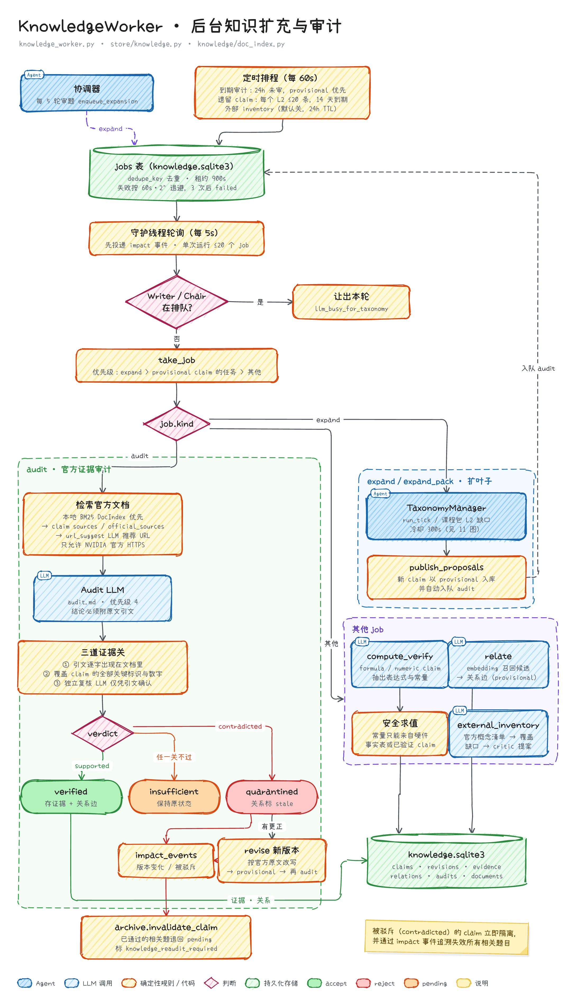

- 守护线程每 5 秒领取一个 job，单次运行最多 20 个；发现 Writer 或 Chair 在排队时主动让出本轮。
- 定时排程：24 小时未审的 claim 进入审计（provisional 优先）；遗留 claim 每个 L2 每轮最多 20 条，14 天内到期；外部 inventory 默认关闭。
- audit 只接受官方 HTTPS 文档（docs.nvidia.com、developer.nvidia.com、nvidia.github.io），优先使用本地 BM25 镜像（`data/docs`）。审计结论要通过三道证据关：引文逐字出现在文档中、引文覆盖 claim 的全部关键标识与数字、独立 LLM 仅凭引文复核通过。
- supported → verified；contradicted → quarantined，并按官方原文改写新版本重新审计；insufficient 保持原状态。
- impact_events → `archive.invalidate_claim`：相关的已通过题退回 pending，并标记 `knowledge_reaudit_required`。
- compute_verify 从 formula / numeric claim 中抽取表达式，常量必须来自硬件事实表或已验证的 claim。relate 用 embedding 召回候选，写入 provisional 关系边。

### TaxonomyManager

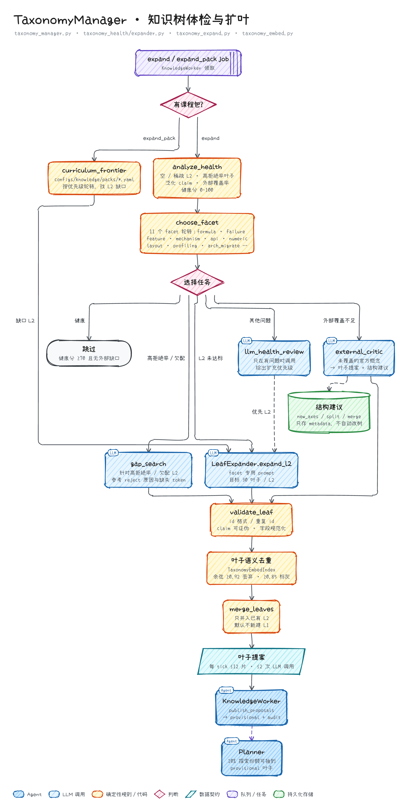

- 协调器每 `every_k_reviews`（默认 5）轮审题入队一次扩充。存在课程包（`configs/knowledge/packs/*.yaml`）时，按优先级轮转补齐 L2 缺口。
- 先体检，再从 11 个 facet 中轮转选一个，最后决定任务：外部覆盖不足做 external_critic，高拒绝率或欠配做 gap_search，L2 未达标（目标 30 叶子 / L2）做扩充；健康分 ≥70 且没有外部缺口时跳过。
- 每个 tick 最多新增 12 片叶子、调用 2 次 LLM。新叶子经过 `validate_leaf` 和语义去重（余弦 ≥0.92 丢弃、≥0.85 标灰）；默认不新建 L1，结构调整建议只存入 metadata，不自动改树。
- 新叶子以 provisional 状态入库并自动审计，Planner 只给它们 10% 的探索份额。导入的旧叶子状态为 `legacy_unreviewed`。

### ApiKeyPool

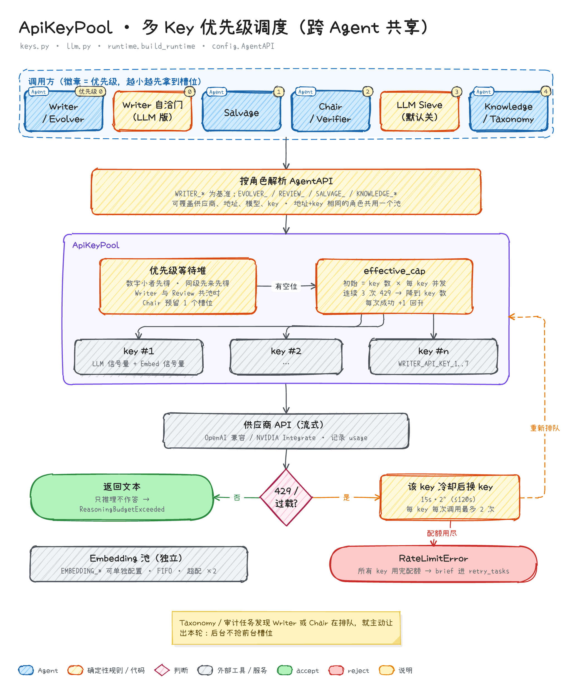

- 优先级：Writer / 自洽门 0 > Salvage 1 > Chair / Verifier 2 > Sieve 3 > Knowledge / Taxonomy 4，同级先来先得。
- 地址与 key 都相同的角色共用一个池。Writer 与 Review 共池时，为 Chair 预留 `chair_slot_reserve`（1）个槽位，保证生成与审题同时推进。
- 每个 key 有独立的 LLM 信号量和 Embedding 信号量；Embedding 可以用 `EMBEDDING_*` 单独配置。
- 遇到 429：该 key 冷却 15s·2ⁿ（上限 120s）后换 key，每个 key 每次调用最多重试 `LLM_RATE_LIMIT_RETRIES_PER_CALL`（2）次。连续 3 次 429 会把并发上限降到 key 的数量，之后每成功一次回升 1。所有 key 的配额都用完时抛出 RateLimitError，题单进入 `retry_tasks`。
- 调用走流式输出并记录 usage。模型只输出推理、没有正文时报 ReasoningBudgetExceeded，不会把推理内容当作答案。

## 题目生命周期

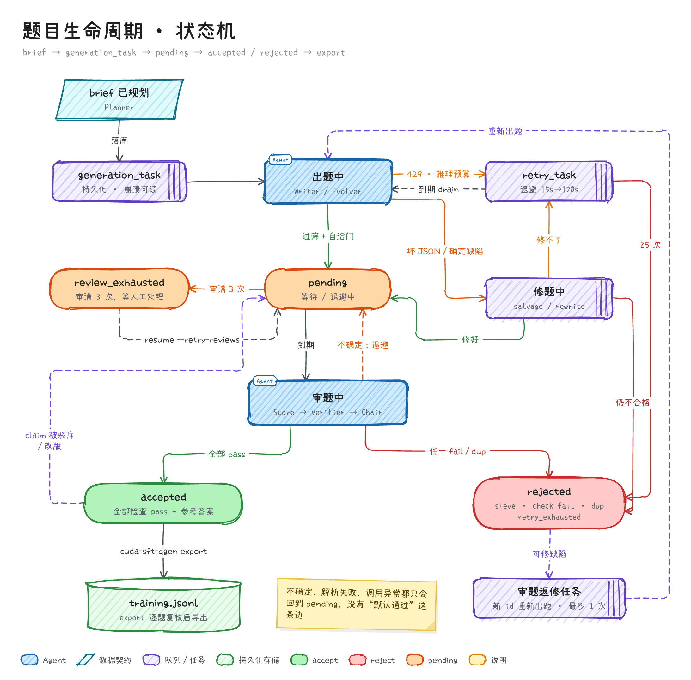

题单先落库再出题。任何失败都有明确去向：修题、重试、退避重审或 rejected。没有任何一条边通向"默认通过"。已通过的题依赖的 claim 被驳斥或改版时，题目会退回 pending 重新审查。

## 数据与存储

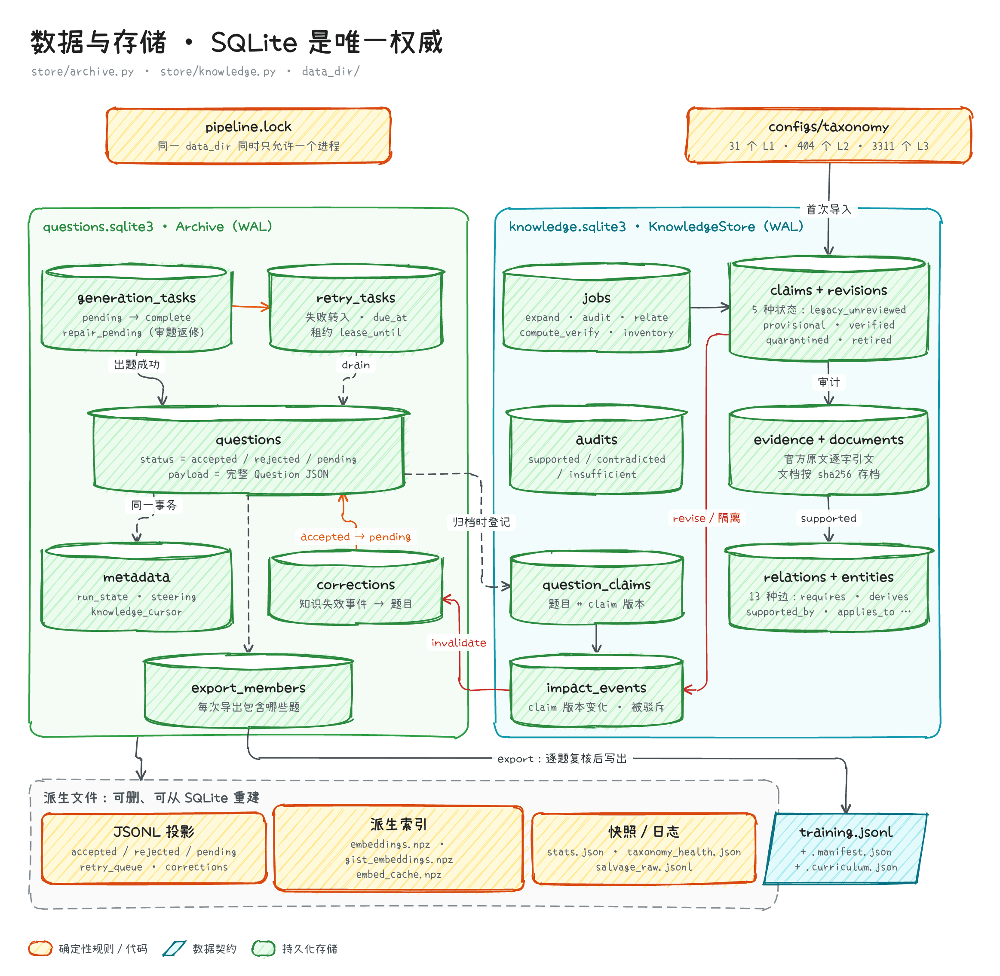

- `questions.sqlite3` 是题目的权威存储：审查结论、生成任务、重试队列、run_state、steering 和知识失效记录都在这里。已有的 JSONL 题库首次使用时会备份为 `.legacy` 并迁移进 SQLite，安装和测试不会自动迁移原始题库。
- `knowledge.sqlite3` 保存 claim 的各个版本、官方证据与文档快照、关系边、审计记录、题目依赖、impact 事件和后台 job。
- JSONL 投影、`embeddings.npz` 等索引、`stats.json` 都是派生文件，可以删除后从 SQLite 重建。
- `cuda-sft-qgen export` 逐题复核：真实 Writer 出身、审查模型不是 fake、QualityReview 可以重建且结论为 accept、结构化题验证 pass、没有合同错误、没有失效。导出结果不含内部参考答案，同时生成 `.manifest.json` 和 `.curriculum.json`。curriculum manifest 把整个父题 family 分到同一个 train / validation / test 集合，并输出分层 10% 的人工抽检队列（未执行人工审核，也不会标记为已审）。
- 迁移、知识审计、导出和基准的细节见 [knowledge-and-review.md](docs/implementation/knowledge-and-review.md)。

## 配置

优先级：**CLI 参数 > 环境变量 > profile YAML > `configs/default.yaml`**。

| Profile | 数据目录 | 特点 |
|---|---|---|
| `dev` | `data/dev` | 4 个写手、审题批次 10、每 10 轮审题扩充一次知识树，适合快速迭代 |
| `test` | `data/test` | 最小资源：2 个写手、批次 5、关闭缓存和 TaxonomyManager |
| `prod` | `data/prod` | 8 个写手、批次 30、每 3 轮审题扩充一次、每个 L2 目标 40 片叶子 |

```bash
CUDA_SFT_PROFILE=dev cuda-sft-qgen generate --target 100
```

在 `configs/profiles/` 下新建 `myprofile.yaml` 即可自定义 profile，只写需要覆盖的字段：

```yaml
generation:
  writer_concurrency: 10
  evolver_fraction: 0.25
review:
  batch_size: 25
  semantic_dup_threshold: 0.93
paths:
  data_dir: data/myprofile
```

其他配置文件：`quotas.yaml`（题型、难度、bloom、硬件、语言配额）、`compat_matrix.yaml`（采样约束与叶子上限）、`angles.yaml`（出题角度卡）、`personas.yaml`、`scope.yaml`、`hardware_facts.yaml`（写入 Writer 与 Chair prompt 的已核实硬件参数）、`taxonomy/cuda.yaml`（按 `domains/` 拆分）、`knowledge/packs/`（课程包）。

常用功能开关：

| 环境变量 | 默认 | 作用 |
|---|---|---|
| `STRUCTURED_COT` | 1 | Writer 返回设计摘要和私有验证合同 |
| `ANSWER_CONSISTENCY_ENABLED` | 1 | 开启独立验证（盲解、rubric、编译、运行） |
| `CUDA_EXECUTION_ENABLED` | 1 | 设为 0 暂停 CUDA runner，需要执行的候选保持 pending |
| `SOLVER_K` / `SOLVER_HIGH_RISK_K` | 3 / 5 | 盲解 solver 数量 |
| `SOLVER_THINKING_LEVEL` / `SOLVER_MAX_TOKENS` | low / 3072 | solver 思考等级与输出上限（难题用 `SOLVER_THINKING_LEVEL_HARD`，默认 medium） |
| `VERIFIER_MAX_CALLS` / `VERIFIER_RUN_MAX_CALLS` | 6 / 600 | 每题 / 每次运行的验证调用上限 |
| `WRITER_CONSISTENCY_GATE` / `WRITER_GATE_LLM` | 1 / 0 | 自洽门；可选 LLM 预审 |
| `SALVAGE_USE_LLM` / `SIEVE_USE_LLM` | 0 / 0 | 用 LLM 修 JSON；用 LLM 做规则筛 |
| `PLANNER_JOINT_SAMPLING` | 1 | 联合约束采样，设为 0 回退旧路径 |
| `CUDA_MIXUP_ENABLED` | 0 | MathMixup 风格配对（decomposed / hybrid） |
| `EXTERNAL_INVENTORY_ENABLED` | 0 | 从官方文档生成外部概念清单，用于发现知识树缺口 |
| `LLM_REQUEST_TIMEOUT` / `LLM_MAX_RETRIES` | 90 / 3 | 单次 HTTP 超时与有限重试 |

- **Mixup**：Planner 用 embedding 找相似但难度不同的已通过题，生成 decomposed（去掉一个复杂度因素）或 hybrid（合并父题并增加正交约束）题。来源记录在 `parent_ids`、`parent_difficulties`、`mixup_mode`、`difficulty_target` 中。父题必须先独立通过 Chair；建议先用真实 API pilot 确认父题对齐、难度单调性和接受率后再开启。
- **外部 inventory**：只用于发现缺口，不直接授权新 claim。流程为：清单 → 覆盖缺口 → critic → 查重 → provisional claim → 官方证据审计。`cuda-sft-qgen knowledge inventory` 默认只预览，加 `--apply` 才发布 provisional claim。

## 性能调优

在 `.env` 中把 N 同时设为写手线程数和可用的聊天槽位。只有一个 key 时可以这样配置 4 路并发；多个 key 时，总槽位 = key 数 × `LLM_PER_KEY_CONCURRENCY`，超出槽位的写手会排队：

```dotenv
WRITER_CONCURRENCY=4
LLM_PER_KEY_CONCURRENCY=4
MIN_GENERATE_BATCH=4
CHAIR_TRIGGER_COUNT=1
CHAIR_MAX_WORKERS=2
REPAIR_CONCURRENCY=2
EMBED_PER_KEY_CONCURRENCY=2
```

- `cuda-sft-qgen probe-concurrency --skip-pipeline` 可以查看实际的 `peak_llm_inflight`。
- Review 与 Writer 共用 API 池时，`chair_slot_reserve` 为待审题保留聊天槽位。
- 并发提高的是批量吞吐，不会缩短单个请求的响应时间。`benchmark_report.json` 中的 `candidate_latency_p95_seconds` 和 `candidate_under_30_rate` 用来验收"单题 30 秒"目标。
- `generation.prompt_cache` 和 `embedding_cache` 默认开启。
- `cuda-sft-qgen estimate-cost --target 1000 --profile prod` 按配置的费率估算成本，不是实测数据。未配置费率时，费用字段为 `null`。

## 验证与已知局限

- FakeLLM 测试只验证协议和错误处理，不能证明生成质量。`generate`、`resume`、`benchmark` 和 `gate` 都强制使用真实 API。
- 真实 pilot 请使用临时数据目录，至少记录：JSON 成功率、claim 对齐、target 一致性、Chair accept / reject / pending、dup / gray 比例、编译与运行通过率、调用次数与 token 成本、平均延迟。日志中不要写入 API key、完整私有 CoT 或敏感请求头。

```bash
CUDA_SFT_DATA_DIR=/tmp/cuda-sft-pilot CUDA_SFT_PROFILE=dev \
cuda-sft-qgen generate --target 8 --batch 4

cuda-sft-qgen agent-pilot --output /tmp/agent-pilot.json \
  --samples 2 --max-calls 160 --timeout 1800 --groups A B C D
```

- `agent-pilot` 在隔离的 archive 中用同一份冻结的 taxonomy 快照和同一组题单做 A/B/C/D 对照：A 是旧版 Writer 基线，B 加结构化 CoT，C 再加独立一致性验证，D 再尝试 Mixup。`status=completed` 只表示流程跑完，不代表质量达标。
- 历史真实评测（记录未纳入本仓库）显示单次 Chair 仍会漏检：在固定的 12 例缺陷集上，默认设置检出 8 个缺陷中的 3 个，medium reasoning 时检出 5 个，4 道对照题全部接受。因此 accept 只是一次运行的操作结果，不能替代官方证据、编译、运行或人工审核。reject 也需要来源复核：官方文档曾纠正过一次审题误判——`cudaMemcpyPeer` 在未开启 peer access 时仍可以经由 host 中转完成，开启 peer access 只是为了走更快的直连路径。
- 静态难度特征只是可解释的排序先验，最终 1–4 难度标签由独立 Chair 校准；本项目尚未做大规模人工难度标定。
- 本项目只导出问题。curriculum manifest 为后续答案生成与训练做准备，目前没有运行 SFT、GRPO 或下游 CUDA 模型训练。

## CLI 速查

| 命令 | 用途 |
|---|---|
| `generate --target N [--batch B] [--rebuild-taxonomy]` | 运行出题流水线 |
| `resume [--retry-reviews] [--data-dir D]` | 断点续跑；可把延后和 exhausted 的题重新排进审题 |
| `stats` / `export --output F` | 覆盖统计；导出通过独立审查的训练集 |
| `knowledge <action>` | 知识图谱：stats、query、audit、impact、export、graph、viz、ingest-pack、expand、relate、inventory、verify、compute-verify、backlog、refine-legacy |
| `manage-taxonomy --analyze / --tick / --expand / --gap-search / --refine [--apply]` | 知识树体检与扩充 |
| `taxonomy health` / `taxonomy expand` / `expand-taxonomy` / `rebuild-taxonomy` | 知识树健康报告与批量扩充 |
| `validate-config [--verbose]` / `estimate-cost --target N` | 配置检查与费用估算 |
| `probe-concurrency` | 实测 API 并发 |
| `benchmark` / `gate` / `review-benchmark` / `agent-pilot` | 隔离的基准、吞吐门禁、审题评测、A/B/C/D 对照 |

```bash
cuda-sft-qgen manage-taxonomy --tick --max-leaves 12 --apply
cuda-sft-qgen manage-taxonomy --expand --domain T02 --facet failure --max-leaves 10 --apply   # T02 = 内存
cuda-sft-qgen knowledge stats
```

## 仓库结构

```text
src/cuda_sft_qgen/
├── graph/            # LangGraph 图、并发协调器、路由策略、各 Agent 节点、handoff 契约
├── planner/          # 联合采样、自适应采样、Mixup 配对
├── prompts/          # writer / evolver / chair / salvage 模板、分层片段、few-shot、taxonomy 提示词
├── review/           # 指纹、查重、多样性、一致性、自洽门、Verifier、CuTe 形状检查
├── store/            # questions.sqlite3（Archive）与 knowledge.sqlite3（KnowledgeStore）
├── knowledge/        # 本地官方文档 BM25 检索
├── taxonomy_health/  # 知识树体检与叶子扩充
├── cli/              # 命令行入口
├── knowledge_worker.py · taxonomy_manager.py · keys.py · llm.py · runtime.py · config.py …
configs/              # default.yaml、profiles/、配额、角度卡、兼容矩阵、硬件事实、taxonomy、课程包
asset/                # 手绘结构图、演示文稿配图（slides/）、PPTX、图的源码（diagram-src/）
docs/implementation/  # 知识审计、导出与注释规范
tests/                # 单元、集成与 fix_v2 契约测试
```

注释约定见 [comment-standard.md](docs/implementation/comment-standard.md)。结构图的重新生成方法见 [asset/diagram-src/README.md](asset/diagram-src/README.md)。
