# cuda-sft-qgen

LangGraph 多智能体流水线，为 NVIDIA CUDA 知识域生成 **SFT 问题集**（本阶段只出题、不出答案）。

出题由版本化知识图谱驱动，保留原有三层分类导航。**每道候选题都经过独立模型完整审查**；无法确认、解析失败或调用失败的题保留待审，不会默认放行。生成与审题并行推进，知识扩充与资料审计在后台运行。

迁移、知识审计、导出和基准说明：[knowledge-and-review.md](docs/implementation/knowledge-and-review.md)。现有 JSONL 首次使用时备份为 `.legacy`，SQLite 成为权威存储；原始题库不会在安装或测试时自动迁移。

## 特性亮点

- **31 个 L1 领域**的三层分层 Taxonomy（Domain → L2 Category → L3 Leaf）
- **多 API Key 优先级调度**：LLM 与 Embedding 独立槽位，支持并行 & 背压控制
- **三层查重**：SHA256 → SimHash/Jaccard → Embedding Cosine（阈值可配置）
- **Prompt Cache + Embedding Cache**：预取优化，节省 60-80% API 成本
- **Retry Queue + Salvage**：容错机制处理 JSON 损坏和 API 429 错误
- **Steering 反馈循环**：Review Chair → Planner 动态纠偏分布失衡
- **知识图谱**：SQLite 断言修订、官方来源证据、依赖关系、后台扩充与每日到期审计
- **事务归档**：审核结果原子提交、可恢复任务、知识纠错影响追踪和问题集导出
- **配置 Profile 支持**：dev/test/prod 预设，环境变量优先级覆盖

## 多 Agent 协同

默认走 **并发协调器**（`generation.concurrent_pipeline=true`）：协调器分别调度 `generation-stage`、`review-stage` 和 `repair-stage`。每道题由真实 Writer API 写完就落入 SQLite pending，第一道可审题立即交给 Chair；JSON 修复和预审重写在独立修题线程执行。Chair 归档保持单消费者，内部仍可并行审核多题。`KnowledgeWorker` 守护线程做知识扩充与官方文档审计。关掉并发后回退到顺序 LangGraph。

LLM 槽位优先级（数字越小越先拿到 key）：**Writer=0 > Salvage=1 > Chair=2 > Sieve=3 > Taxonomy=4**。正式生题必须使用真实 API；Chair 对 `formula/debug/layout/code_complete` 的 uncertain 结果会再审一次；连续审题失败触发熔断。

### 总览：并发流水线（默认）

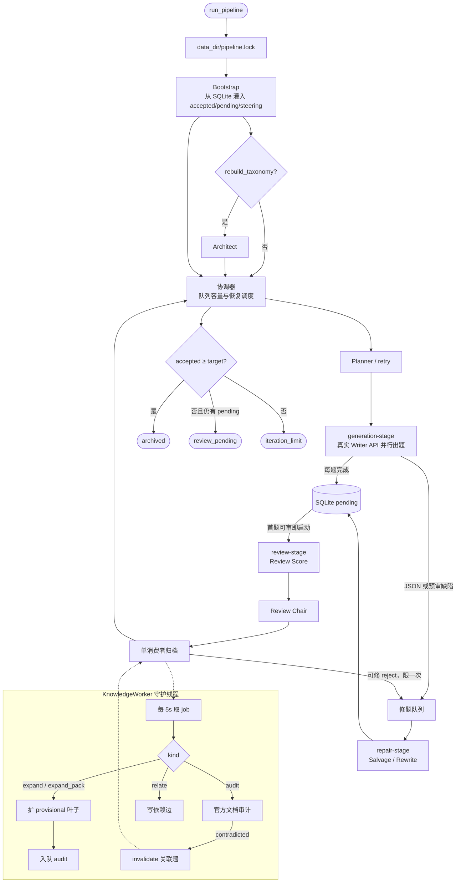

| Agent | 模块 | 作用 |
|---|---|---|
| **Bootstrap** | `graph/nodes/bootstrap.py` | 从 archive 恢复计数、pending、steering、run_state |
| **Architect** | `graph/nodes/architect.py` | 可选首轮：把 Taxonomy 扩充任务丢给后台 worker |
| **Planner** | `graph/nodes/planner.py` + `planner.py` | 配额 + steering + 叶子硬件兼容，抽 Writer/Evolver 任务单 |
| **Writer / Evolver** | `graph/nodes/generate.py` | 并行出题；规则筛只拦空泛题；hw/leaf 记 warning 进 pending |
| **Salvage** | `generate.salvage_item` / `salvage.py` | 修损坏 JSON，不改题意；修不了进 retry 队列 |
| **Review Repair** | `review_archive.py` / `salvage.py` | 可修 reject 入持久任务；真实 Writer 重写后重新进入 pending，最多一次 |
| **Retry Drain** | `graph/nodes/salvage.py` | 到期 429/JSON 任务再跑一轮 Writer |
| **Review Score** | `graph/nodes/review.py` | embedding 近邻 + 三层指纹；不在此步放行 |
| **Review Chair** | `graph/nodes/review.py` | 每题独立审查；失败/不确定保留 pending，绝不默认 accept |
| **Archivist** | `graph/nodes/review.py` `archive_node` | SQLite 事务提交；登记知识依赖；投影 JSONL |
| **Taxonomy / Knowledge** | `knowledge_worker.py` | 后台扩叶子、官方证据审计、修订失效关联题 |

### 顺序图（`concurrent_pipeline=false`）

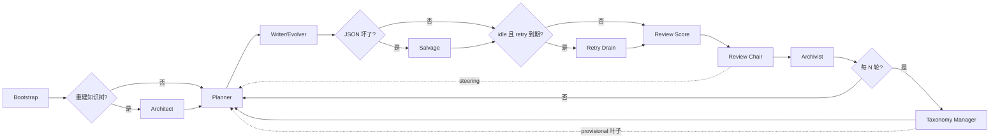

---

### Bootstrap

从磁盘把一次可恢复运行灌进图状态。不调 LLM。

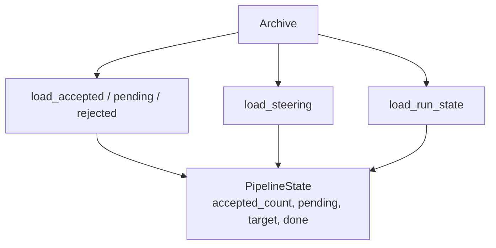

- 输入：`questions.sqlite3`（及 JSONL 投影）
- 输出：`pending`、`steering_brief`、`iteration` / `review_rounds`
- `accepted ≥ target` 且无 pending 时直接结束

### Architect

仅 `--rebuild-taxonomy` 时走一次。本身不阻塞出题，只把扩叶子任务排队。

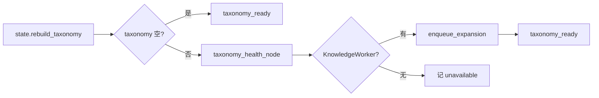

### Planner

按配额缺口、Chair steering、叶子健康度抽 **QuestionBrief**。硬件标签必须与叶子 claim 兼容（`leaf_hardware_allowed`），避免 Writer 写出立刻被 hw 筛掉的题。

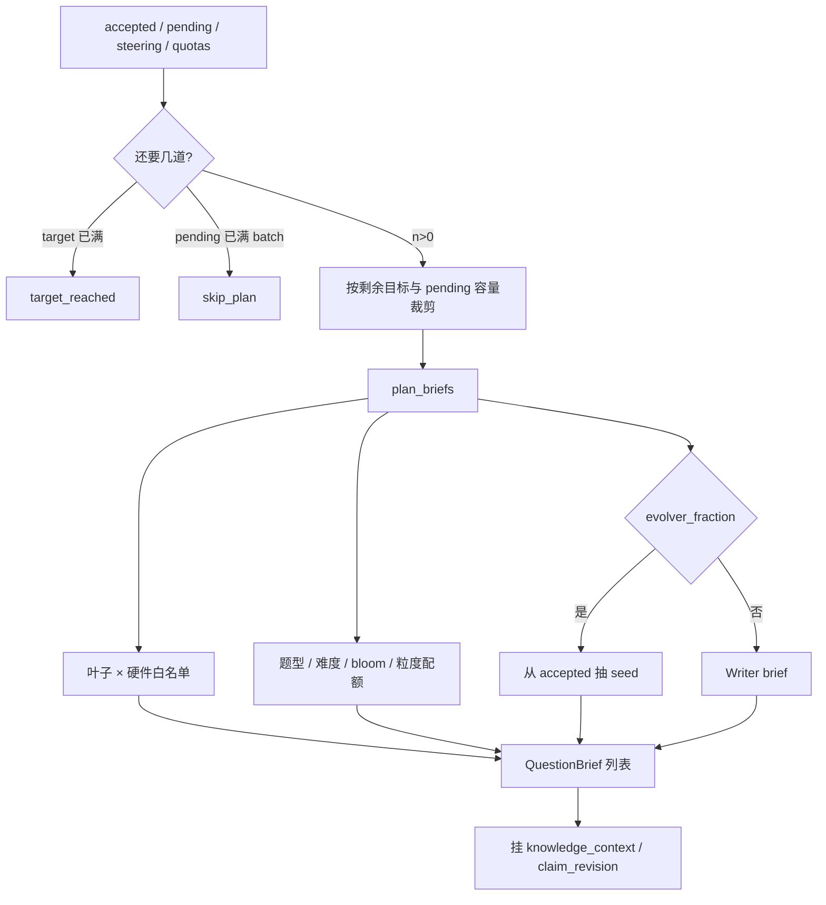

- 自适应采样：`configs/planner.yaml` 的 `adaptive_sampling`（可关）
- Evolver 优先取同一叶子的已通过题作为 seed；没有时再取相关叶子。
- 输出：`batch_briefs`；只有实际规划时 iteration +1。`max_iterations` 是单次运行额度，resume 保留累计计数并获得新额度。

### Writer / Evolver

一条 brief 一次 LLM。Evolver 改训练结构，不是同义改写。并发由 `PriorityExecutor` + API key 池背压控制。

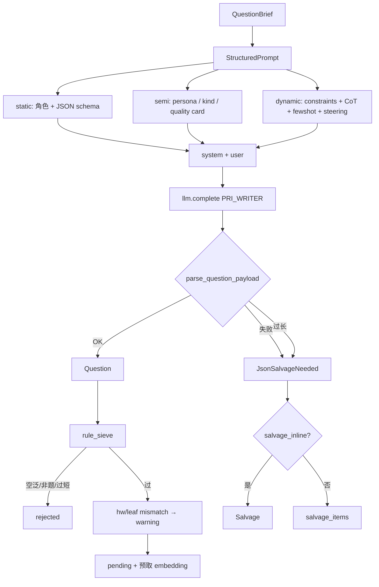

Prompt 分层：`writer.md` / `evolver.md` + `layers/{constraints,quality,context,cot,writer_policy,evolver_policy}.md`。

规则筛（`sieve.py`）只拦：过短过长、缺 claim、不像问题、不像 CUDA、开口太空。`sieve_hw_mismatch` / `sieve_off_leaf` 在 Writer 路径上是 warning，交给 Chair。

### Salvage

只修 JSON 外壳，不改考点。本地解析优先，再可选 Salvage LLM。

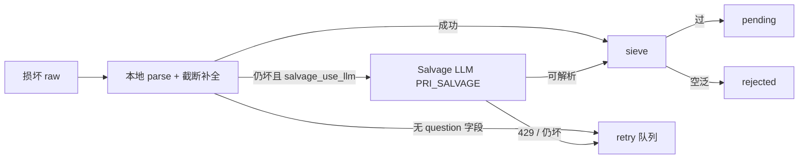

Retry 队列：指数退避；超过 `RETRY_MAX_ATTEMPTS` 记 `retry_exhausted`。

### Retry Drain

pending 为空（或并发协调器里还有审题空位）且队列到期时，把 brief 再送进 Writer。新鲜出题优先于 JSON 重试，避免 drain 堵满审题。

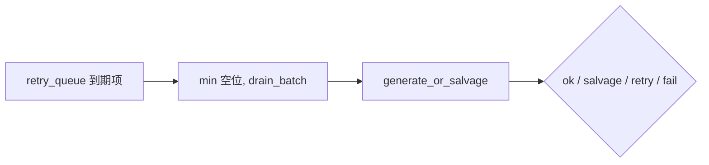

### Review Score

检索邻居、打多样性报告。**不在这一步 accept**。到期未审的题才进本批；backoff / exhausted 的题延后。

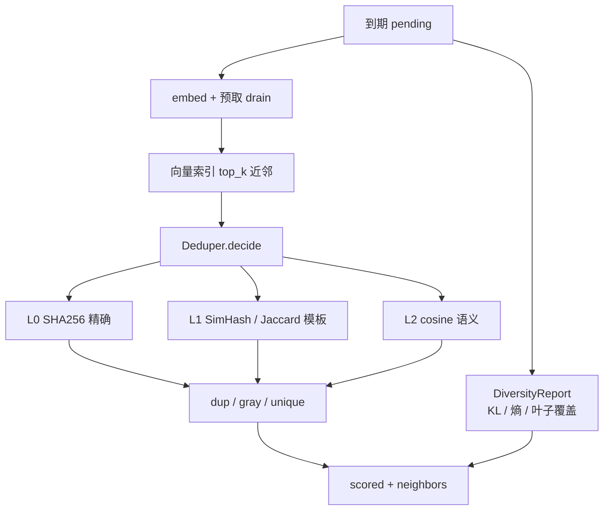

### Review Chair

每道候选（含 unique）各打一次独立审查。解析失败、ID 对不上、证据不足、调用失败 → **pending**，带指数退避，用尽后 `review_exhausted` 留待人工，永不默认放行。

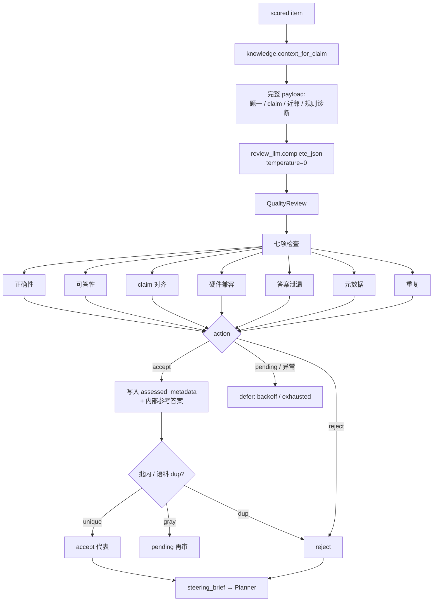

Chair 并发：`chair_max_workers`。审查模型可用独立 `review.model`，缺省与出题模型相同。

### Archivist

审查结果与计数一次事务提交。向量索引是派生数据，失败不影响权威库。

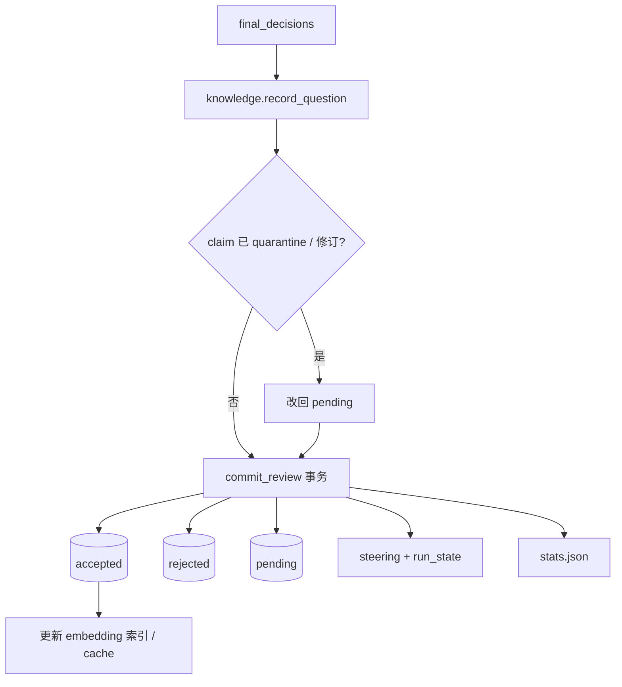

导出训练数据用 `cuda-sft-qgen export`：只要独立审查通过、非 fake、未失效的题；内部参考答案不导出。

### Taxonomy Manager / KnowledgeWorker

不插入出题/审题主线。主循环每 `every_k_reviews` 轮 `enqueue_expansion`；worker 自己租约执行。

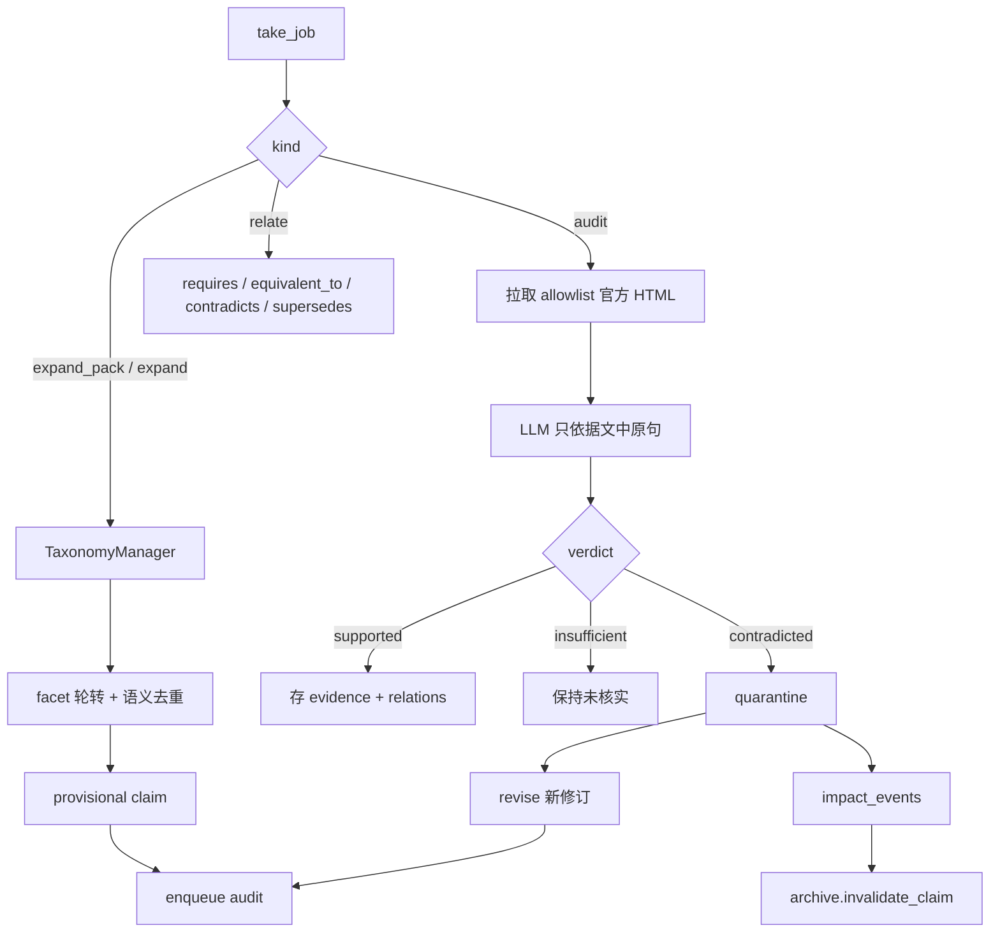

新叶子立即可被 Planner 抽到；官方审计通过前状态为 `provisional`。导入的旧叶子是 `legacy_unreviewed`。

### API Key 池（跨 Agent）

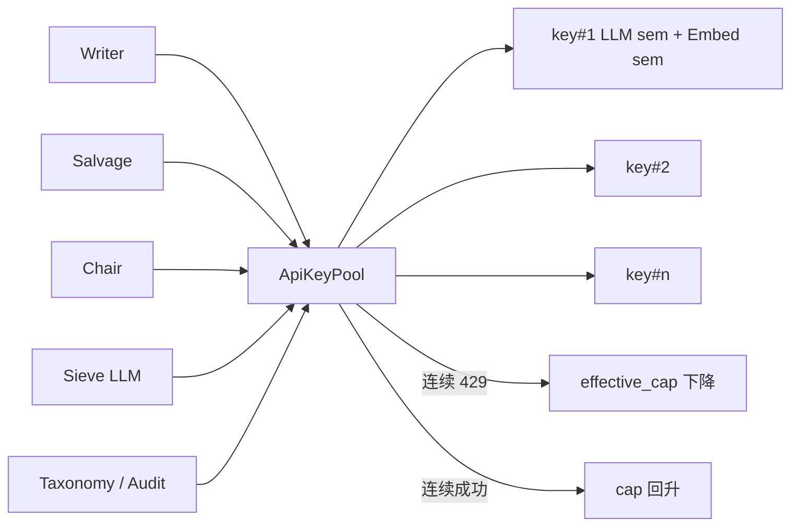

LLM 与 Embedding 信号量独立。优先级数字：**Writer=0 > Salvage=1 > Chair=2 > Sieve=3 > Taxonomy=4**。Chair 默认 `review.priority=2`，不再与 Writer 抢同一档。

注释约定见 [comment-standard.md](docs/implementation/comment-standard.md)。

### 系统上下文（启动到落盘）

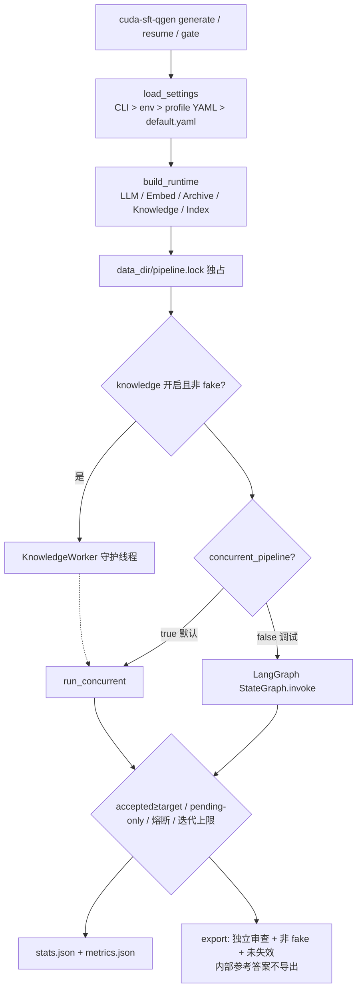

### 交接契约（MAST：避免智能体错位）

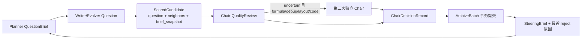

### 错误状态机

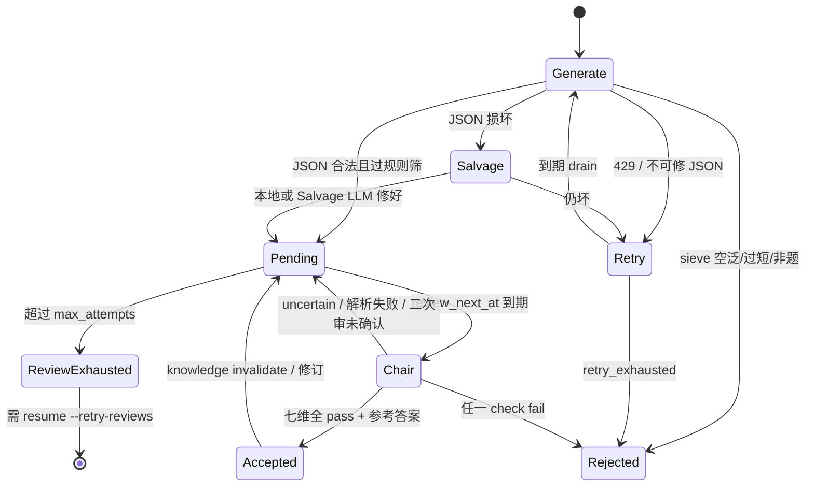

熔断：连续 `review_error` 达到 `circuit_breaker_error_streak`，或 `review_exhausted` 达到 `circuit_breaker_exhausted`，主循环以 `status=review_pending` 停，不空转。
独立验证的单次运行调用额度用尽时，主循环以 `status=verification_budget_exhausted` 停止新增任务，待审题不消耗重试次数；下一次 `resume` 可继续审题。

### SQLite 权威存储与导出

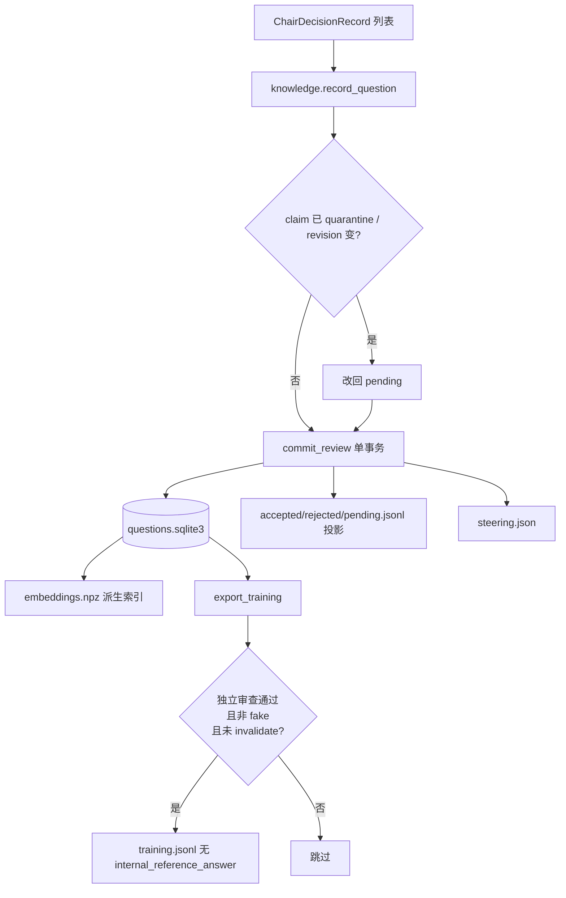

durable generation_tasks 与 retry 租约也在 `questions.sqlite3`：进程崩溃后 `resume` 先跑未完成 task，再抽新 brief。

## 快速开始

```bash
python -m venv .venv && source .venv/bin/activate
pip install -e ".[dev]"
cp .env.example .env   # 按下方说明配置聊天和 embedding 的 API key
```

**基础命令**：
```bash
# 生成 1000 题（使用默认配置）
cuda-sft-qgen generate --target 1000

# 使用 dev profile（快速迭代）
export CUDA_SFT_PROFILE=dev
cuda-sft-qgen generate --target 100

# 使用 prod profile（最高质量）
export CUDA_SFT_PROFILE=prod
cuda-sft-qgen generate --target 5000

# 恢复中断的生成
cuda-sft-qgen resume

# 查看统计数据
cuda-sft-qgen stats

# 验证配置
cuda-sft-qgen validate-config --verbose

# 估算成本
cuda-sft-qgen estimate-cost --target 1000 --profile prod
```

**Taxonomy 管理**：
```bash
# 重建知识树
cuda-sft-qgen rebuild-taxonomy

# 健康分析
cuda-sft-qgen manage-taxonomy --analyze

# 完整管理周期（分析 + 扩展）
cuda-sft-qgen manage-taxonomy --tick --max-leaves 12 --apply

# 手动扩展指定领域
cuda-sft-qgen manage-taxonomy --expand --domain memory --facet failure --max-leaves 10 --apply
```

产物：`data/questions.sqlite3`、`data/knowledge.sqlite3`，以及 accepted/rejected/pending JSONL 和统计快照。正式训练导出使用 `cuda-sft-qgen export --output data/training.jsonl`，排除未独立审查、fake 和失效题；内部参考答案不导出。

查重：L0 SHA256 → L1 骨架 SimHash/Jaccard → L2 embedding cosine；附近邻全文交给审题模型，批内只与质量通过的存活题比较。向量默认 `nvidia/nemotron-3-embed-1b`。

聊天使用 OpenAI 兼容中转、embedding 保持 NVIDIA 时，在 `.env` 中配置：

```dotenv
WRITER_PROVIDER=openai
WRITER_API_KEY=your-key
WRITER_BASE_URL=https://www.poke2api.com/v1
WRITER_MODEL=gpt-6-luna
REVIEW_MODEL=gpt-6-sol
THINKING_LEVEL=medium
WRITER_GATE_MAX_TOKENS=2048
EMBEDDING_PROVIDER=nvidia
EMBEDDING_API_KEY=your-nvidia-key
EMBEDDING_BASE_URL=https://integrate.api.nvidia.com/v1
EMBEDDING_MODEL=nvidia/nemotron-3-embed-1b
```

Evolver、Review、Salvage、Knowledge 可分别用 `EVOLVER_*`、`REVIEW_*`、`SALVAGE_*`、`KNOWLEDGE_*` 覆盖 Writer 的供应商、密钥、地址和模型；更换供应商或地址时需同时提供新地址和密钥。`THINKING_LEVEL=none|low|medium|high`。OpenAI 格式发送 `reasoning_effort`，NVIDIA 格式使用 `chat_template_kwargs`；`reasoning_content` 默认不落盘（`LOG_REASONING=1` 才记）。`validate-config` 检查各角色与 embedding 配置。

## 配置系统

### Profile 支持

三种内置 profile（`configs/profiles/`）：

- **dev.yaml**: 快速迭代，较小 batch，温度 0.9
- **test.yaml**: 最小资源，单线程，禁用 Taxonomy Manager
- **prod.yaml**: 严格质量，最大吞吐，温度 1.0

**使用方式**：
```bash
# 环境变量
export CUDA_SFT_PROFILE=prod
cuda-sft-qgen generate --target 2000

# 或在代码中
from cuda_sft_qgen.config_v2 import load_config_v2
config = load_config_v2(profile="dev", target=500)
```

### 配置优先级

CLI 参数 > 环境变量 > Profile YAML > default.yaml

**示例**：
```bash
# 使用 prod profile 但覆盖温度
export CUDA_SFT_PROFILE=prod
export TEMPERATURE=0.85
cuda-sft-qgen generate --target 1000
```

### 自定义 Profile

创建 `configs/profiles/myprofile.yaml`：
```yaml
generation:
  temperature: 0.95
  writer_concurrency: 10
  evolver_fraction: 0.25

review:
  batch_size: 25
  semantic_dup_threshold: 0.93

paths:
  data_dir: data/myprofile
```

使用：
```bash
CUDA_SFT_PROFILE=myprofile cuda-sft-qgen generate --target 2000
```

## 性能调优

### 并发设置

在 `.env` 中将 N 同时用于 Writer 线程数和可用的聊天 API 槽位；一个 key 时如下配置为 4 路。多个 key 时总槽位为 key 数量乘 `LLM_PER_KEY_CONCURRENCY`。超过槽位的 Writer 会排队。

```dotenv
WRITER_CONCURRENCY=4
LLM_PER_KEY_CONCURRENCY=4
WRITER_SUBMIT_STAGGER_SEC=0
MIN_GENERATE_BATCH=4
CHAIR_TRIGGER_COUNT=1
CHAIR_MAX_WORKERS=2
REPAIR_CONCURRENCY=2
```

`cuda-sft-qgen probe-concurrency --skip-pipeline` 可查看实际 `peak_llm_inflight`。地址和密钥相同的角色共享 API 池；embedding 可单独配置。Review 与 Writer 共用 API 池时，`chair_slot_reserve` 为待审题保留聊天槽位。并发提高批量吞吐，不缩短单个模型请求的响应时间；`benchmark_report.json` 中的 `candidate_latency_p95_seconds` 和 `candidate_under_30_rate` 用于验收单题 30 秒目标。

```bash
# 多 API Key 线性扩展（最多推荐 8 个）
export WRITER_API_KEY=nvapi-xxx
export WRITER_API_KEY_2=nvapi-yyy
export WRITER_API_KEY_3=nvapi-zzz

# 每个 key 的并发数（2-4 推荐，过高会 429）
export LLM_PER_KEY_CONCURRENCY=3
export EMBED_PER_KEY_CONCURRENCY=2

# Embedding 超配（可以更高，调用更快）
export EMBED_OVERSUB=3
```

### 缓存优化

```yaml
generation:
  prompt_cache: true         # 节省 ~60% prompt tokens
  embedding_cache: true      # 节省 ~80% embedding calls
```

### 质量控制

```yaml
review:
  semantic_dup_threshold: 0.94   # 提高=更少判重
  semantic_gray_threshold: 0.90  # 灰区范围
  chair_max_workers: 4          # 每题均审查，此项控制并发
```

### 成本估算

```bash
# 预估 1000 题成本
cuda-sft-qgen estimate-cost --target 1000 --profile prod

# 典型输出（3 keys, prod profile）:
# {
#   "cost_usd": {
#     "llm_total": 22.50,
#     "embeddings": 0.85,
#     "total": 23.35
#   }
# }
```

**性能与费用口径**：上面的费用命令使用配置费率估算，不代表本次实测。
真实延迟、API 调用数和 provider token usage 见 `docs/validation/`。
未配置费率时报告费用为 `null`；本次没有证实历史的吞吐或成本宣传值。

## 结构化 CoT、Mixup 与真实 Agent 验证

启用 `STRUCTURED_COT=1` 时，Writer 的真实 API 请求按四个内部阶段组织：

```text
Analyze → Plan → Construct → Self-check
```

`draft_plan` 和 `draft_target` 只用于后续验证，不会进入 `Question.to_jsonl()` 或训练导出。Seed 会优先从相同 `l3_id + kind + question_type + hardware` 桶中抽取，避免把不相关的 CUDA 机制混入同一个 few-shot prompt。

启用 MathMixup 风格生成时，Planner 使用 claim/topic embedding 配对相似但难度不同的 accepted 题目，并生成：

- `decomposed`：保留核心 claim，减少一个可观测复杂度因素；
- `original`：原始 accepted 题；
- `hybrid`：合并相关父题并增加正交约束。

新增质量功能尚未通过生产验收，`prompt_cot`、`answer_consistency_enabled`、Mixup、外部 inventory 默认关闭。可显式启用并用隔离 pilot 验证，不能用 FakeLLM 通过率代替质量验证。

Pair provenance 保存在 `parent_ids`、`parent_difficulties`、`mixup_mode` 和 `difficulty_target` 中。默认关闭 Mixup，确认真实 API pilot 的 parent alignment、难度单调性和 Chair 接受率后再开启：

```yaml
mixup:
  enabled: false
  fraction: 0.30
  modes: [decomposed, hybrid]
  pair_similarity_min: 0.80
  pair_similarity_max: 0.995
```

也可以用 `CUDA_MIXUP_ENABLED=1` 临时启用。生产 pair mining 使用运行时 embedding 服务；没有 embedding 服务时才使用稳定的 hashed-token fallback，后者只适合离线测试。

### 验证顺序

候选题按以下顺序处理：

```text
schema/sieve
→ claim、hardware、版本检查
→ cheap dedup
→ Writer self-check
→ target 一致性
→ CUDA 编译或 litmus evidence
→ 独立 Review Chair
→ archive
```

可验证标量/符号题默认进行 5 次独立 solver 调用，配置支持 3–5 次；solver 仅看到题干，不接收 tests_claim、Writer target 或父题答案。投票冲突进入 `pending`；不能因为没有工具或 API 超时而默认通过。

验证由 `verification_spec.mode` 决定，不能仅凭题型推断。`compile` 使用完整 translation unit 和正/负编译预期；`runtime` 在 bubblewrap 隔离、无网络、无凭据环境执行，限制 CPU、文件大小和时长，仅暴露 GPU 设备（包含 WSL `/dev/dxg`）。缺少工具、架构不匹配、超时或 runner 被禁用时保持 pending。二次 Chair 复用本轮已生成的 verifier evidence，不重复执行 K 次 Solver；跨题调用由原子运行预算限制。负向 runtime 合同可指定 `expected_runtime_outcome=sanitizer_error` 和明确诊断词；只有工具实际报告该错误才确认。死锁不能用超时证明，一次成功运行不能证明不存在竞态或 UB。

数值答案用安全 AST/Fraction 归一化；符号答案需要 `pip install -e ".[verify]"`。开放题生成 3 个回答再独立评分，在同主题/kind/hardware 桶内按最低分筛选，不使用全局分数阈值。

### 外部知识覆盖

KnowledgeWorker 可以从 allowlisted NVIDIA 文档、Runtime API 文档索引、release notes 和 Nsight 文档生成外部概念清单。清单只用于发现 taxonomy 缺口，不直接授权新 claim：

```text
external inventory
→ embedding/lexical coverage gap
→ taxonomy critic
→ duplicate/gray 检查
→ provisional claim
→ 官方 evidence audit
→ verified claim（随后可供 Planner 使用）
```

`external_inventory_enabled` 默认关闭以避免未经配置的网络抓取。开启后，外部 coverage 低于 `taxonomy.manager.external_coverage_threshold` 会触发 critic，即使现有 taxonomy 的普通 health score 已经较高。无法归入已有 L2 的新分类轴只记录在 `new_axes`，不会自动写入 active taxonomy。

也可以显式运行一次 inventory（默认只预览；`--apply` 才发布 provisional claims）：

```bash
cuda-sft-qgen knowledge inventory --data-dir data/dev
cuda-sft-qgen knowledge inventory --apply --data-dir data/dev
```

### 真实 API pilot

FakeLLM 测试只验证协议和错误处理，不能证明 Agent 生成质量。真实 pilot 应使用临时数据目录和项目现有 `.env`：

```bash
CUDA_SFT_DATA_DIR=/tmp/cuda-sft-pilot \
CUDA_SFT_PROFILE=dev STRUCTURED_COT=1 ANSWER_CONSISTENCY_ENABLED=1 \
cuda-sft-qgen generate --target 8 --batch 4
```

Pilot 至少记录：JSON 成功率、claim alignment、target consistency、Chair accept/reject/pending、duplicate/gray rate、parent claim coverage、难度单调性、编译/smoke pass rate、token/call 成本和平均延迟。不得把 API key、完整私有 CoT 或敏感请求头写入日志。

Archive 还可以生成 curriculum manifest：

```python
archive.export_curriculum_manifest(Path("data/curriculum.json"))
```

`export` 同时生成 `.curriculum.json`，两种导出复用独立审查门槛。manifest 记录父题 family，整个 family 分到同一个 train/validation/test split，并输出分层 10% 人工抽检队列（未执行人工审核，不标已审）。

manifest 的默认训练顺序是 `decomposed → original → hybrid`，但 `mixup_mode` 与 assessed difficulty 是两个独立维度，训练端应按联合 bucket 采样。

### 真实验证记录

汇总结论与验收边界见 [RESULTS.md](docs/validation/RESULTS.md)。

真实验证产物保存在 `docs/validation/`，文件权限为 `0600`，其中只保留公开题干、来源证据、脱敏统计和错误码，不保留 API key、完整请求、私有答案或模型推理：

- `cuda-tools-negative.json`：真实 memcheck 捕获预期的越界全局写错误，验证负向 runtime 合同。
- `cuda-tools.json`：CUDA 12.6、WSL RTX 3060（sm_86）的真实编译、运行、负编译和 Compute Sanitizer 结果；sm_90 因本机架构不匹配而保持 pending。
- `knowledge-confirmation.json`：加入 material token/数字覆盖检查与第二次独立审核后的重验记录（以文件中最终状态为准）。
- `knowledge-pilot.json`：真实 NVIDIA LLM/Embedding 对官方 release notes 的概念发现、critic、provisional claim 和 evidence audit。历史结果中有一条 claim 通过逐字官方证据审计；后续代码还要求完整关键标识/数字覆盖与独立再次确认。
- `review-quality-reasoning.json`：同一 12 例使用 medium reasoning/8192 tokens 时检出 5/8 个缺陷、仍漏检 3 个，对照题 4/4 接受；不是统计显著性或 CUDA 全域效果证明。
- `review-quality.json`：12 个 frozen quality cases 的真实 Chair 结果。当前模型在固定缺陷集上检出 3/8 个缺陷、漏检 5 个，4/4 对照题接受；这项结果只能说明单次 Chair 仍有漏检，不能作为数据质量达标证明。
- `verification-live.json`：真实盲 solver 对受控 scalar 题的 5 票一致性、错误 writer target 的 pending，以及开放题响应不足时的 pending。
- `agent-pilot-small-abcd.json`：后续受限运行已尝试全部四组，但因 API 延迟、模型合同错误和 deadline 仍为 partial；不能据此宣称质量通过。
- `agent-pilot.json`：A/B/C/D 真实 Agent 对照运行的增量 checkpoint。`status=completed` 只代表流程结束；`quality_gates` 只衡量样本量条件，不证明质量改善。此轮历史运行是 partial，小样本和预算中断均只用于诊断。
- `mixup-targeted.json`：两个真实独立 Chair 接受的父题及其真实 Mixup 尝试；没有合格父题时明确记录 `not_evaluated`。

运行新的真实对照需要 NVIDIA API key 和真实 embedding：

```bash
cuda-sft-qgen agent-pilot \
  --output docs/validation/agent-pilot.json \
  --samples 2 --max-calls 160 --timeout 1800 \
  --groups A B C D
```

`--samples` 为每类样本数（默认 8 类），调用预算按组均分，重试与截止退出会记录 partial。生产关闭验证时，带结构化验证合同的题不能被接受/导出；B 因此只可观察 Chair 的 model_action，不宣称已验证。

该命令使用临时 archive、固定 taxonomy 快照和相同 brief 集合。A 是旧 Writer 基线，B 加结构化 CoT，C 再加独立一致性，D 再尝试 Mixup；父题必须在 D 组内独立通过 Chair。`accept` 只表示该次运行的操作结果，不能替代官方证据、编译、运行或人工审核。

CUDA 官方文档曾用于纠正一个真实 reviewer 误判：`cudaMemcpyPeer` 在未启用 peer access 时仍可通过 host staging 工作；启用 peer access 的作用是避免 staging 并获得更快的 peer path。由此可见，reviewer 的 reject 也必须由来源或执行证据复核。


### 配置与限制

| 环境变量 | 作用 |
|---|---|
| `STRUCTURED_COT=1` | 启用结构化设计摘要和私有验证合同 |
| `ANSWER_CONSISTENCY_ENABLED=1` | 启用独立求解/开放题评分/工具合同验证 |
| `CUDA_MIXUP_ENABLED=1` | 开启相关题配对；默认关闭 |
| `CUDA_EXECUTION_ENABLED=0` | 暂停 CUDA runner；需执行的候选保持 pending |
| `SOLVER_K` / `SOLVER_HIGH_RISK_K` | 默认 3/5；每题调用还受 `VERIFIER_MAX_CALLS` 与全运行 `VERIFIER_RUN_MAX_CALLS` 限制 |
| `SOLVER_THINKING_LEVEL` / `SOLVER_MAX_TOKENS` | 紧凑 solver 输出预算 |
| `LLM_REQUEST_TIMEOUT` / `LLM_MAX_RETRIES` | 单次 HTTP 超时与有限重试（总实验还需 pilot deadline） |
| `EXTERNAL_INVENTORY_ENABLED=1` | 后台单独调度官方资料 inventory job |

`knowledge inventory` 未指定 `--apply` 时只预览；新 L1/L2、拆分/合并建议持久化供复核，不自动重排知识树。
静态难度特征是可解释的排序先验，最终 1–4 标签由独立 Chair 校准；未宣称完成大规模人类难度标定或下游训练。
本项目依然只导出问题，curriculum manifest 为后续答案生成与训练准备；本次没有运行 SFT、GRPO 或下游 CUDA 模型训练。
